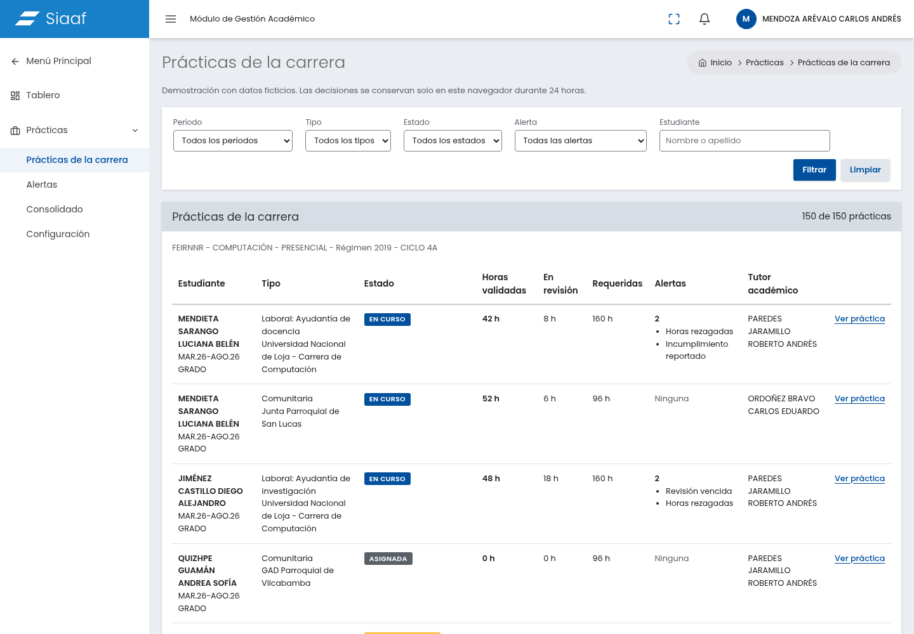
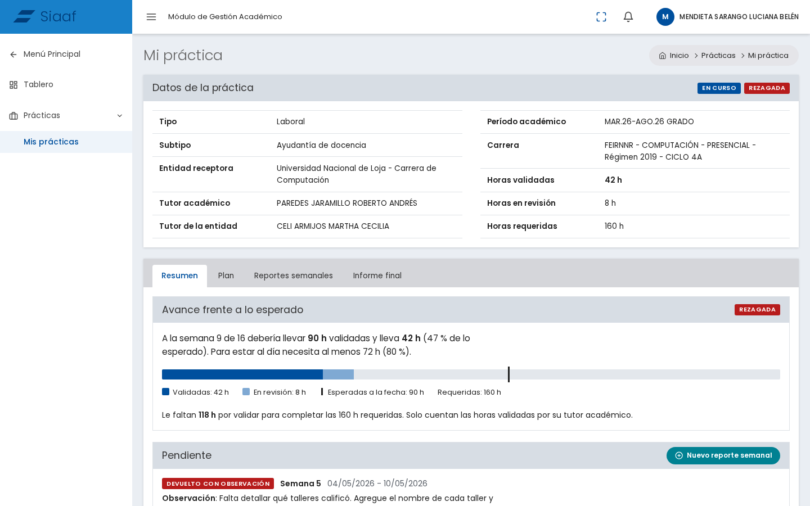
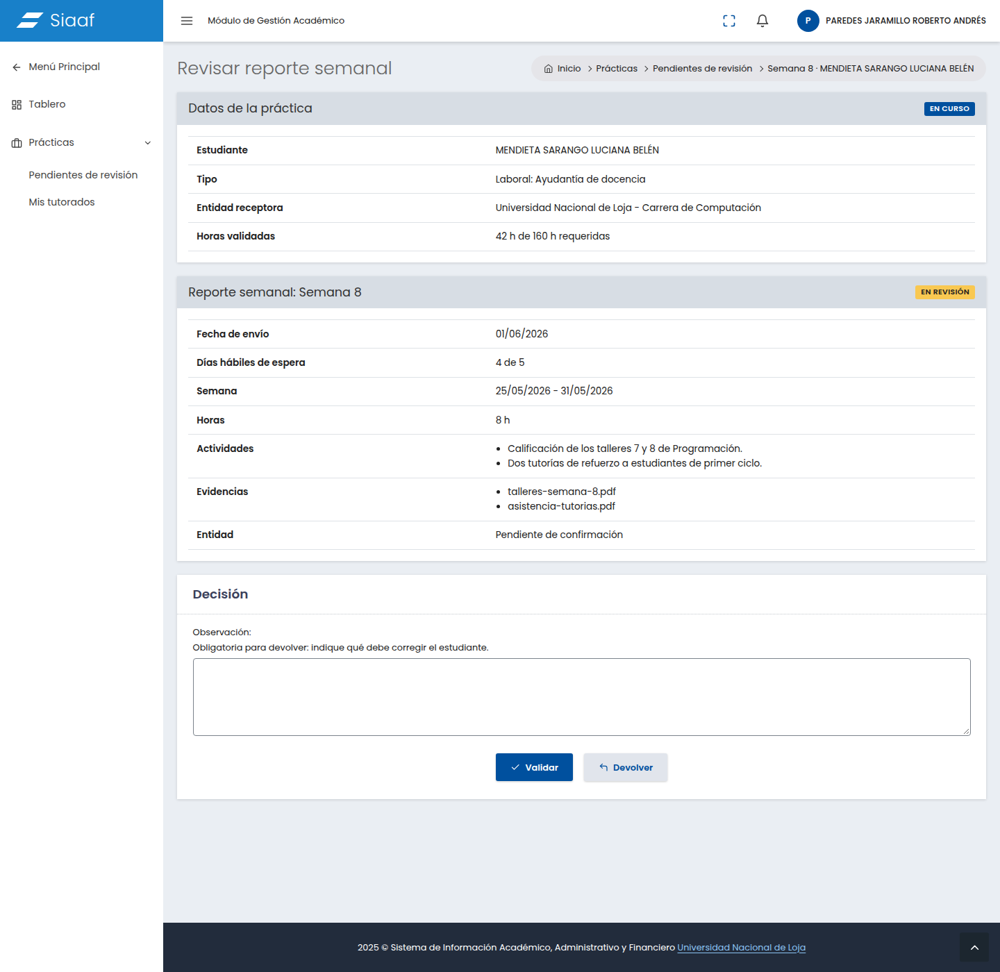
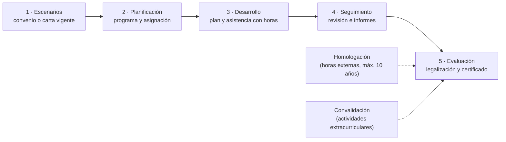

<div align="center">

# Sistema de gestión de prácticas preprofesionales

**Seguimiento y trazabilidad de las prácticas de la Universidad Nacional de Loja (UNL),<br>desde el convenio hasta el certificado.**

[](https://github.com/Jaimewww/sistema-practicas-preprofesionales-unl/actions/workflows/ci.yml)
[](https://sonarcloud.io/summary/new_code?id=Jaimewww_sistema-practicas-preprofesionales-unl)
[](https://jaimewww.github.io/sistema-practicas-preprofesionales-unl/)
<br>


[Inicio rápido](#inicio-rápido) ·
[El problema](#el-problema) ·
[Actores](#actores) ·
[Proceso](#proceso) ·
[Alcance](#alcance) ·
[Documentación](#documentación) ·
[Contribuir](#cómo-trabajar-en-este-repositorio)

</div>

---

| Coordinador de carrera | Estudiante | Tutor académico |
| :---: | :---: | :---: |
|  |  |  |

---

## Inicio rápido

> [!TIP]
> No hace falta `.env` para desarrollo. Las variables opcionales están documentadas en `backend/.env.example`.

<table>
<tr>
<th>Local (Python 3.12+ y Git)</th>
<th>Docker (Compose v2 + PostgreSQL 17)</th>
</tr>
<tr>
<td>

```bash
make install   # crea .venv e instala dependencias
make run       # http://127.0.0.1:8000
make test      # suite del backend
```

</td>
<td>

```bash
export DJANGO_SECRET_KEY="$(python3 -c 'import secrets; print(secrets.token_urlsafe(50))')"
export POSTGRES_PASSWORD="$(python3 -c 'import secrets; print(secrets.token_urlsafe(24))')"
docker compose up --build
```

</td>
</tr>
</table>

Comprobá que responde:

```bash
curl http://127.0.0.1:8000/health/
# → {"status": "ok", "checks": {"database": "ok"}}
```

| Qué abrir | Dirección |
| --- | --- |
| Prototipo del coordinador | <http://127.0.0.1:8000/prototipo/coordinador/practicas/> |
| Consolidado del analista DVS | <http://127.0.0.1:8000/prototipo/dvs/consolidado/> |
| Swagger de la API | <http://127.0.0.1:8000/api/v1/docs/> |
| Esquema OpenAPI | <http://127.0.0.1:8000/api/v1/schema/> |

Más detalle (variables, Docker, prototipo) en [Ambiente de desarrollo](#ambiente-de-desarrollo).

---

## El problema

En la UNL las prácticas son **obligatorias para titularse** y tienen dos componentes: **laborales** (pasantías o ayudantías de cátedra e investigación) y **servicio comunitario**.

Hoy **no están centralizadas**: cada carrera usa sus propios repositorios, formatos y procesos. La Dirección de Vinculación con la Sociedad (DVS), que supervisa el tema, no tiene una base única de convenios y cartas de compromiso. Para pedir informes finales insiste a cada carrera por oficios, correos y mensajes, y recibe respuestas tardías o incompletas.

> [!IMPORTANT]
> La gestión está **fragmentada y sin trazabilidad**: no hay una vista única del avance de cada estudiante, de los convenios vigentes ni del cumplimiento de horas, y la documentación se legaliza a mano.
>
> El sistema debe **dar seguimiento a un proceso con varias etapas**, no solo guardar formularios.

---

## Actores

| | Actor | Rol en el proceso | Qué necesita del sistema |
| :---: | --- | --- | --- |
| 🎓 | **Estudiante** | Se postula o es asignado, planifica actividades, registra asistencia, sube evidencias y responde la encuesta. | Saber en qué etapa está, cuántas horas lleva y qué documentos le faltan; descargar su certificado. |
| 🧑‍🏫 | **Docente responsable** (por carrera) | Gestiona convenios y cartas, arma el programa, asigna estudiantes y emite el informe de cumplimiento. | Centralizar planes y asistencias, revisar y aprobar o rechazar con observaciones, reasignar tutor si el docente cesa. |
| 📝 | **Tutor académico** | Orienta el plan de actividades, hace seguimiento, retroalimenta, evalúa y legaliza documentos. | Lo mismo que el docente responsable. |
| 🏢 | **Tutor institucional** | Monitorea al estudiante y emite el informe final. No aplica en servicio comunitario. | Registrar su informe y su evaluación sin burocracia. |
| 🏛️ | **Director de carrera** | Aprueba el programa, las homologaciones y convalidaciones, y emite el certificado final. | Aprobar sin papel, con evidencia clara de quién hizo qué y cuándo. |
| 🗂️ | **Secretaría de carrera** | Revisa y legaliza la documentación. | Legalizar sin papel, con el mismo rastro de evidencia. |
| 📊 | **Analista de prácticas (DVS)** | Crea escenarios y encuestas, consolida datos y genera reportes. | Convenios y escenarios en un solo lugar, reportes consolidados sin pedirlos a cada carrera, satisfacción medida para decidir renovaciones. |
| 🤝 | **Entidad receptora** | Recibe estudiantes mediante convenio o carta de compromiso. | Que su informe final y su evaluación se registren sin burocracia. |
| ⚖️ | **Rectorado, Procuraduría, Decanato** | Aprueban y revisan convenios y firman cartas. | — |

---

## Proceso



| Etapa | Qué pasa |
| --- | --- |
| **1. Gestión de escenarios** | Con convenio o carta de compromiso vigente, se registra, aprueba y habilita el escenario. |
| **2. Planificación y asignación** | Se designa responsable y tutores, se elabora el programa, el director lo aprueba y se asigna a los estudiantes. |
| **3. Desarrollo** | El estudiante registra su plan de actividades y la asistencia con las horas. |
| **4. Seguimiento** | El tutor revisa, el institucional informa y el responsable elabora el informe de cumplimiento. |
| **5. Evaluación y acreditación** | Se evalúa, se legalizan los anexos, se emite el certificado y se aplica la encuesta de satisfacción. |
| **Flujos paralelos** | Homologación (horas ya cumplidas en otra institución, con máximo 10 años de antigüedad) y convalidación (actividades extracurriculares reconocidas como prácticas). |

<details>
<summary><b>Respuestas a las preguntas iniciales</b></summary>

- **Asignación o aprobación:** el responsable arma el programa, el director lo aprueba y luego se asigna a los estudiantes. El escenario debe tener convenio o carta vigente.
- **Actores:** los de la tabla anterior, desde el escenario hasta el certificado.
- **Evidencias:** plan de actividades, registro de asistencia con horas, informe del tutor institucional, informe de actividades, evaluación y encuesta de satisfacción.
- **Control del avance:** horas cumplidas frente a horas requeridas, y estado de cada documento (pendiente, en revisión, legalizado, devuelto).
- **Alertas útiles:** convenio por vencer, horas rezagadas, documento pendiente de revisión o legalización, informe no entregado, tutor sin asignar o reemplazado, y encuesta pendiente.

</details>

---

## Alcance

| ✅ Incluye (MVP) | 🔜 Fase posterior | ⛔ Fuera de alcance |
| --- | --- | --- |
| Autenticación con roles | Homologación y convalidación | Cálculo de notas académicas |
| Catálogo de entidades y escenarios, con convenios, cartas y vigencia | Encuesta de satisfacción y analítica | Gestión financiera |
| Programas de prácticas y asignación de estudiantes | Integración con el sistema académico | Firma electrónica avanzada |
| Portafolio del estudiante: plan, asistencia y evidencias | | |
| Flujo de revisión y aprobación con estados | | |
| Evaluación y certificado de cumplimiento | | |
| Alertas y reportes básicos | | |

### Criterios de éxito

- Un solo repositorio de convenios, cartas y escenarios, con estado de vigencia.
- Cada práctica con trazabilidad completa: quién, qué, cuándo y en qué estado.
- Avance de horas por estudiante y por carrera sin pedir informes por oficio.
- Certificado generado una vez legalizados todos los anexos.
- Reportes consolidados para la DVS en minutos.
- Alertas que se disparan antes de que ocurra el incumplimiento.
- Control de acceso: cada rol ve y hace solo lo que le corresponde.

### Restricciones conocidas

| Tipo | Restricción |
| --- | --- |
| **Normativa** | El Reglamento CES y el reglamento UNL fijan las horas. El estudio cita 240 h laborales y 120 h comunitarias en modalidad presencial; Derecho, Odontología y Laboratorio Clínico exigen 480 h laborales; a distancia son 256 h y 144 h. Deben ser **configurables por carrera** y verificarse con la normativa vigente. |
| **Variabilidad** | Las carreras de Salud usan internado rotativo y externado. El servicio comunitario no requiere tutor institucional. Solo Rectorado aprueba convenios. |
| **Tecnológica** | En el proyecto real: autenticación centralizada (SAC), Python/Django/PostgreSQL por lineamiento de DTI, mismo diseño visual que el SIAAF, respuesta de 2 a 10 segundos y compatibilidad con cualquier navegador. En el proyecto académico el stack puede ser libre. |
| **De información** | El instructivo estaba en construcción, así que los procesos pueden haber cambiado. Falta validar con usuarios reales. |

---

## Papel del backend

El backend es lo que hace que el sistema sea más que un almacén de formularios.

| Capacidad | Para qué |
| --- | --- |
| 🔁 **Máquina de estados** | Etapas de la práctica y de los documentos, con transiciones válidas (no se certifica sin anexos legalizados). |
| 📏 **Reglas de negocio** | Convenio vigente, acumulación de horas contra las requeridas por carrera y modalidad, asignación y reemplazo de tutores. |
| 🔐 **RBAC** | Autenticación y autorización por roles, con aislamiento de datos por carrera. |
| 🧾 **Auditoría** | Historial inmutable de cambios y aprobaciones: la base de la trazabilidad. |
| 📎 **Evidencias** | Almacenamiento seguro de archivos con metadatos y versionado. |
| ⏰ **Tareas y notificaciones** | Alertas por vencimientos, retrasos y pendientes. |
| 📄 **Documentos y reportes** | Certificados, informes y matrices consolidadas exportables. |
| 🔌 **API** | Integraciones con el sistema académico o la entidad receptora. |

**Entidades núcleo:** Usuario/Rol · Carrera · Entidad receptora · Convenio/Carta · Escenario · Programa · Asignación (estudiante–práctica–tutor) · Plan de actividades · Registro de asistencia · Evidencia/Documento · Evaluación · Certificado · Alerta · Bitácora de auditoría.

---

## Ambiente de desarrollo

El backend es un proyecto **Django 5.2** que arranca con un solo comando, probado con Python 3.12 a 3.14 en Linux y macOS.

| Comando | Qué hace |
| --- | --- |
| `make install` | Crea el venv `.venv` e instala `backend/requirements.txt`. |
| `make install-dev` | Agrega las stubs de tipado (`django-stubs`) para los analizadores estáticos. |
| `make run` | Levanta `http://127.0.0.1:8000` con `DEBUG` encendido. |
| `make test` | Corre la suite de tests del backend. |

> [!NOTE]
> Fuera de `make run`, `DEBUG` queda apagado salvo que se defina `DJANGO_DEBUG=True`. Con `DEBUG` apagado hay que definir `DJANGO_ALLOWED_HOSTS`.

<details>
<summary><b>Prototipo de Coordinador y Analista DVS</b></summary>

<br>

El menú del coordinador permite consultar alertas, detalle e historial, cerrar prácticas, suspender/reanudar/cancelar, exportar el consolidado y configurar horas y plazos. El analista consulta y exporta entre carreras. Solo aparecen prácticas cerradas en los consolidados.

Los datos son ficticios; las decisiones y la configuración se guardan en ese navegador por 24 horas y se pueden restablecer desde Configuración. Las horas requeridas de las prácticas existentes se conservan. Las rutas del prototipo responden 404 cuando `DEBUG=False`; no necesitan migraciones. Ver [escenarios y evidencias](evidencias/prototipo-coordinador-verificacion.md).

El API de alertas y cierre (#61) alimenta C2 y C4: `GET /prototipo/api/v1/alertas/` filtra por actor/carrera y `POST /prototipo/api/v1/practicas/<id>/cierre/` verifica los requisitos e indica qué falta con `409`. La API y las pantallas reflejan las decisiones del mismo navegador; el cierre exige CSRF. La persistencia compartida entre usuarios queda para otro issue. Ver [contrato](docs/api.md#8-alertas-y-cierre-implementados-melissa-61) y [verificación](evidencias/api-alertas-cierre-verificacion.md).

</details>

<details>
<summary><b>Docker: servicios, variables y arranque</b></summary>

<br>

La imagen (`Dockerfile`, Python 3.13) instala `backend/requirements-dev.txt`. `docker-compose.yml` define dos servicios: `api` (Django, puerto 8000) y `db` (PostgreSQL 17, con volumen `pgdata` y healthcheck).

Las variables se toman del shell o de un `.env` local junto a `docker-compose.yml`. Compose lo lee solo, y el archivo está ignorado por git, así que nunca se sube con valores reales.

| Variable | Obligatoria | Valor por defecto | Uso |
| --- | :---: | --- | --- |
| `DJANGO_SECRET_KEY` | ✅ | — | Clave de Django. Usá un valor largo y aleatorio. |
| `POSTGRES_PASSWORD` | ✅ | — | Contraseña del usuario de la base. |
| `DJANGO_DEBUG` | | `True` | Con `True` se habilitan las rutas del prototipo. |
| `DJANGO_ALLOWED_HOSTS` | | `localhost,127.0.0.1` | Hosts permitidos. |
| `POSTGRES_DB` / `POSTGRES_USER` | | `practicas` | Base y usuario que crea el servicio `db`. |
| `POSTGRES_HOST` / `POSTGRES_PORT` | | `db` / `5432` | Los fija el compose para el servicio `api`. |

Al arrancar, `docker/entrypoint.sh` espera a PostgreSQL, ejecuta `migrate` y, solo con `DJANGO_SEED_DEMO=True` y si existe el comando `seed`, carga los datos de demo. El compose local activa esa variable por defecto; en producción no se define, así que nunca se cargan datos ficticios (`DJANGO_SEED_DEMO=False docker compose up` arranca sin demo). Django se conecta a PostgreSQL mediante las variables `POSTGRES_*` del compose; con `DEBUG` apagado y sin esas variables, `settings.py` falla en vez de caer a SQLite.

```bash
docker compose exec api python manage.py test  # suite dentro del contenedor
docker compose down                             # apagar (agregar -v borra el volumen de la base)
```

</details>

**API:** Swagger y el esquema OpenAPI son anónimos solo con `DEBUG` encendido; si no, exigen token. El contrato completo está en [`docs/api.md`](docs/api.md). El demo con `X-Rol` vive aparte, en `/prototipo/api/v1/`.

---

## Documentación

| | Documento | Contenido |
| :---: | --- | --- |
| 🌐 | [Portal técnico (Quarto)](https://jaimewww.github.io/sistema-practicas-preprofesionales-unl/) | Toda la documentación publicada desde `develop`. Localmente: `quarto preview`. |
| 📐 | [`specs/`](specs/) | Especificaciones de las funcionalidades. |
| 🏗️ | [`docs/arquitectura.md`](docs/arquitectura.md) · [`docs/adr/`](docs/adr/README.md) | Arquitectura y decisiones (ADR). |
| 🔌 | [`docs/api.md`](docs/api.md) | Contrato de la API. |
| 🛡️ | [`docs/seguridad.md`](docs/seguridad.md) | Seguridad. |
| 🧭 | [`docs/trazabilidad.md`](docs/trazabilidad.md) | Trazabilidad de requisitos. |
| 🖼️ | [`evidencias/`](evidencias/) | Capturas y verificaciones del prototipo. |

---

## Cómo trabajar en este repositorio

El repo usa **GitFlow**. Antes de tocar código:

1. Leé [`CONTRIBUTING.md`](CONTRIBUTING.md): modelo de ramas y convención de commits.
2. Leé [`docs/constitution.md`](docs/constitution.md): principios del equipo.
3. Registrá tu aporte en [`docs/contribuciones.md`](docs/contribuciones.md) y tu uso de IA en [`docs/declaracion-ia.md`](docs/declaracion-ia.md). Las fuentes van en [`docs/bibliografia.md`](docs/bibliografia.md).

---

## Fuente y trabajos previos

> [!NOTE]
> **Fuente principal:** Trabajo de Integración Curricular de Guamán y Novillo (UNL, enero 2025), que desarrolló un módulo de prácticas para el SIAAF. Se apoya en el Reglamento de Régimen Académico de la UNL, en el instructivo de prácticas (en construcción en ese momento) y en entrevistas con la DVS.
>
> Como ya existe ese módulo dentro del SIAAF, este proyecto es una propuesta distinta para el banco académico: ese trabajo es **referencia, no algo a copiar**.
