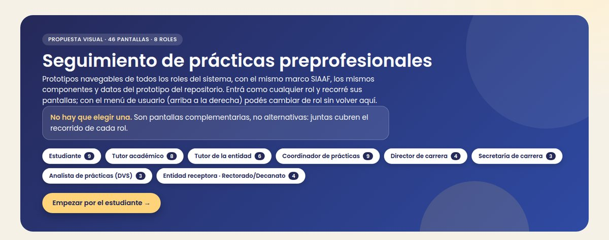
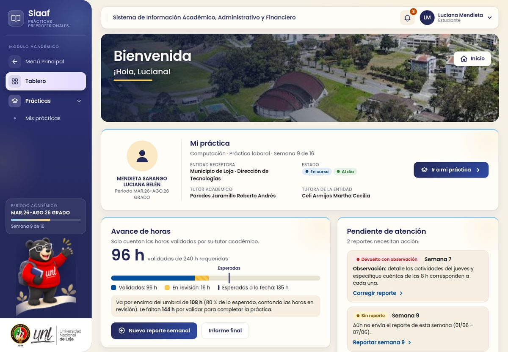
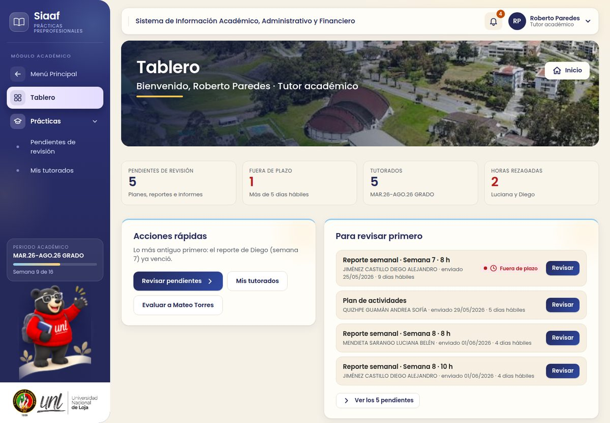
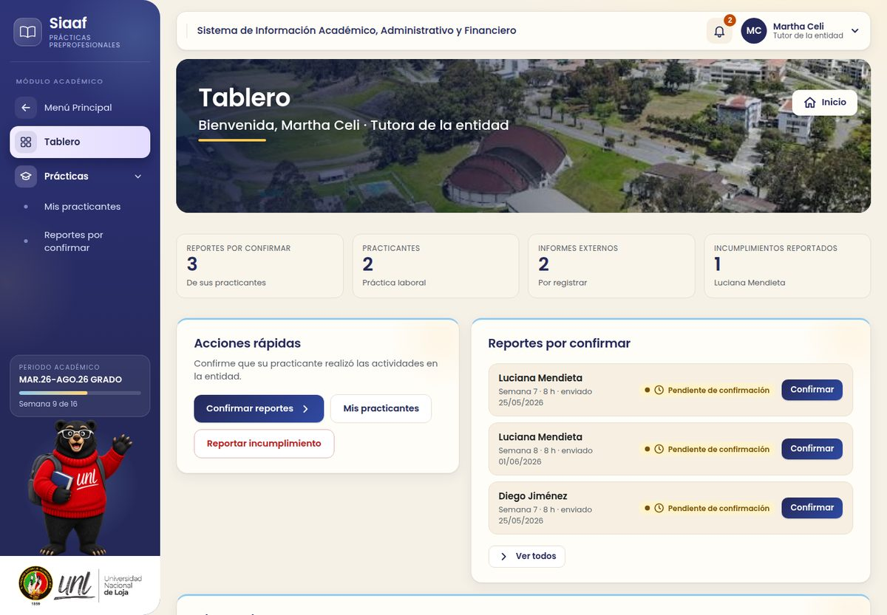
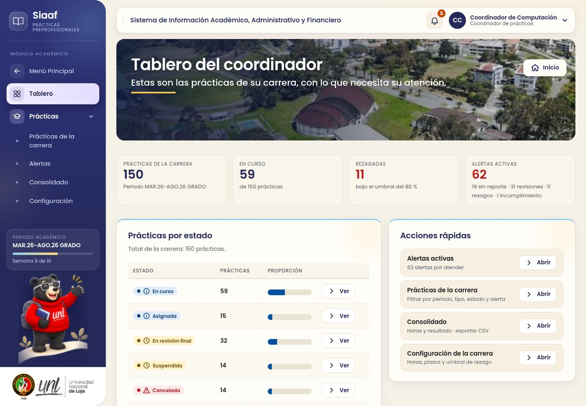
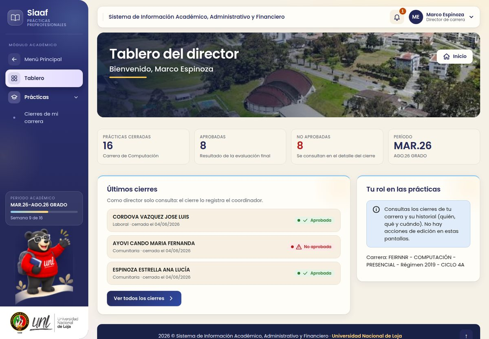
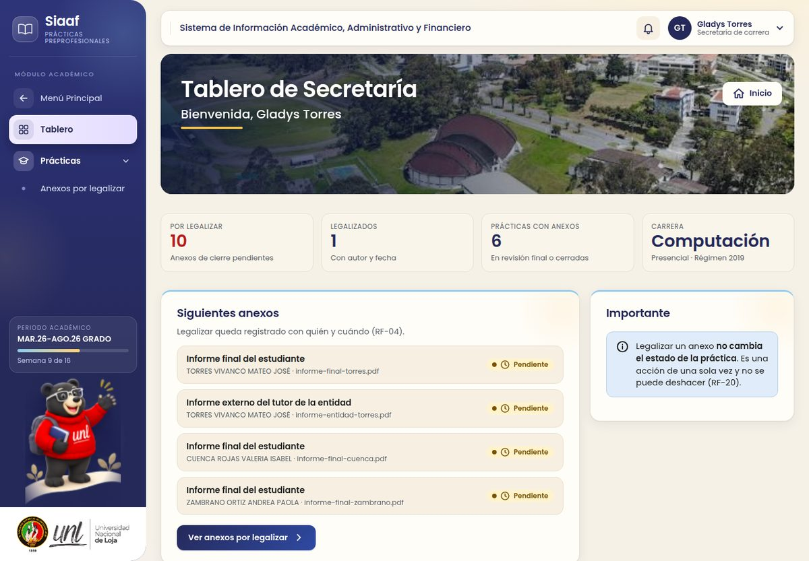
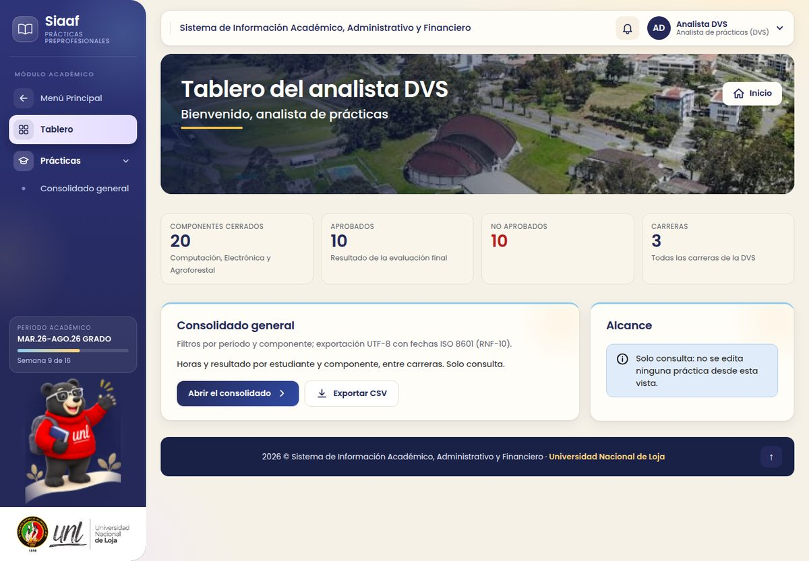
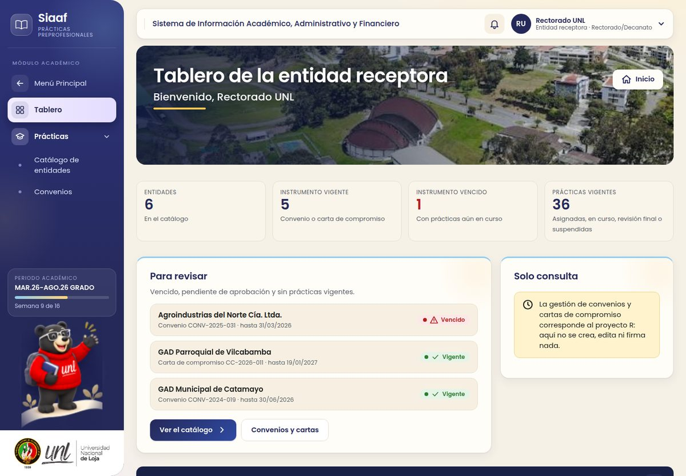
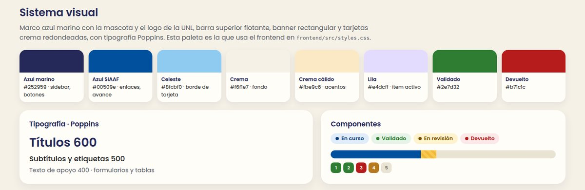

# Propuesta de diseño del frontend

Prototipos visuales de la interfaz del sistema de seguimiento de prácticas preprofesionales, con el estilo del SIAAF renovado: barra lateral azul marino con la mascota y el logo de la UNL, barra superior flotante, banner rectangular, tarjetas crema redondeadas y tipografía Poppins. **46 pantallas para los 8 roles**, cada una en su carpeta.



## Roles y pantallas

Haga clic en un rol para ver todas sus pantallas.

<table>
<tr><td width="270"><a href="estudiante/"></a></td><td valign="top"><b><a href="estudiante/">Estudiante</a></b> · 9 pantallas<br>Quien realiza la práctica: registra su plan, reporta cada semana sus horas y evidencias, presenta su informe final y ve cuántas horas lleva.</td></tr>
<tr><td width="270"><a href="tutor-academico/"></a></td><td valign="top"><b><a href="tutor-academico/">Tutor académico</a></b> · 8 pantallas<br>Docente que acompaña la práctica: revisa planes, reportes e informes finales, registra la evaluación y sigue a sus tutorados.</td></tr>
<tr><td width="270"><a href="tutor-entidad/"></a></td><td valign="top"><b><a href="tutor-entidad/">Tutor de la entidad</a></b> · 6 pantallas<br>Persona de la entidad receptora: confirma los reportes de sus practicantes, registra su informe y reporta incumplimientos.</td></tr>
<tr><td width="270"><a href="coordinador/"></a></td><td valign="top"><b><a href="coordinador/">Coordinador de prácticas</a></b> · 9 pantallas<br>Responsable de prácticas de la carrera: ve el estado de todas las prácticas, atiende alertas, suspende o cierra prácticas y obtiene el consolidado.</td></tr>
<tr><td width="270"><a href="director/"></a></td><td valign="top"><b><a href="director/">Director de carrera</a></b> · 4 pantallas<br>Consulta los cierres de su carrera y su historial, en solo lectura.</td></tr>
<tr><td width="270"><a href="secretaria/"></a></td><td valign="top"><b><a href="secretaria/">Secretaría de carrera</a></b> · 3 pantallas<br>Legaliza los anexos de cierre de las prácticas.</td></tr>
<tr><td width="270"><a href="analista/"></a></td><td valign="top"><b><a href="analista/">Analista de prácticas (DVS)</a></b> · 3 pantallas<br>Consulta el consolidado entre carreras y lo exporta a CSV.</td></tr>
<tr><td width="270"><a href="entidad-receptora/"></a></td><td valign="top"><b><a href="entidad-receptora/">Entidad receptora · Rectorado/Decanato</a></b> · 4 pantallas<br>Consulta el catálogo de entidades receptoras y los convenios (fuera del MVP, solo consulta).</td></tr>
</table>

## Cómo verlo

- **Aquí en GitHub:** cada carpeta de rol tiene un `README.md` con las capturas de todas sus pantallas.
- **Con sus botones y filtros:** descargue o clone el repositorio y abra [`system.html`](system.html) en el navegador. Es el tablero maestro: lista las 46 pantallas y tiene un botón para entrar como cada rol. Dentro de cualquier pantalla, el menú de usuario (arriba a la derecha) permite cambiar de rol.

## Qué se puede probar

La mascota UNL de la barra lateral está animada: saluda sola al cargar la pantalla y cada pocos segundos, reacciona al pasar el cursor o enfocarla con el teclado, y al hacer clic (o Enter/Espacio) saluda y muestra un globo con un mensaje. Si el sistema tiene activada la opción «reducir movimiento», se queda quieta y el clic solo muestra el globo.

## Sistema visual



El frontend usa esta paleta como variables CSS en [`frontend/src/styles.css`](../../frontend/src/styles.css).

## Estructura

```text
docs/diseno/
├── system.html             tablero maestro (abrir en el navegador)
├── assets/                 fuente Poppins, logo de la UNL, mascota, foto del campus
├── estudiante/             00-tablero … 08-informe-final
├── tutor-academico/        00-tablero … 07-evaluacion-final
├── tutor-entidad/          00-tablero … 05-reportar-incumplimiento
├── coordinador/            00-tablero … 07-configuracion
├── director/               00-tablero … 03-historial
├── secretaria/             00-tablero … 02-legalizar
├── analista/               00-tablero … 02-exportacion
└── entidad-receptora/      00-tablero … 03-convenios
```

Cada carpeta de rol tiene además `capturas/` con una imagen por pantalla.

## Notas

- Son maquetas con datos de ejemplo, solo de interfaz: no hay lógica de servidor.
- Los identificadores (E1, T2, C4, D1, S2, A1, N1…) son los de [`docs/mapa-pantallas.md`](../mapa-pantallas.md).
- La mascota y la foto del campus están pendientes de confirmar permisos de uso.
