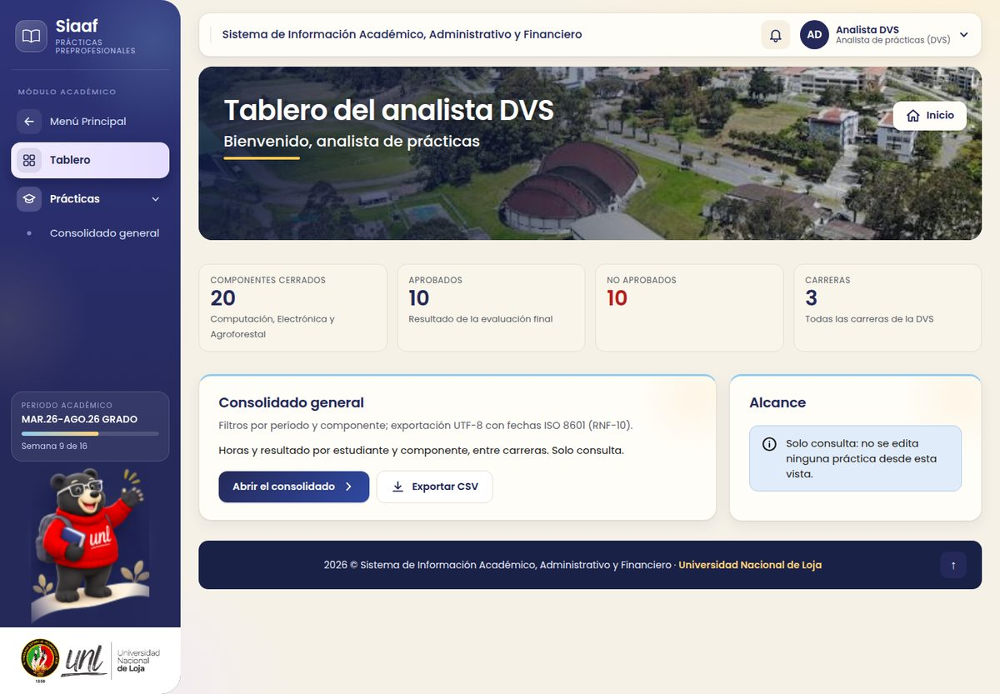
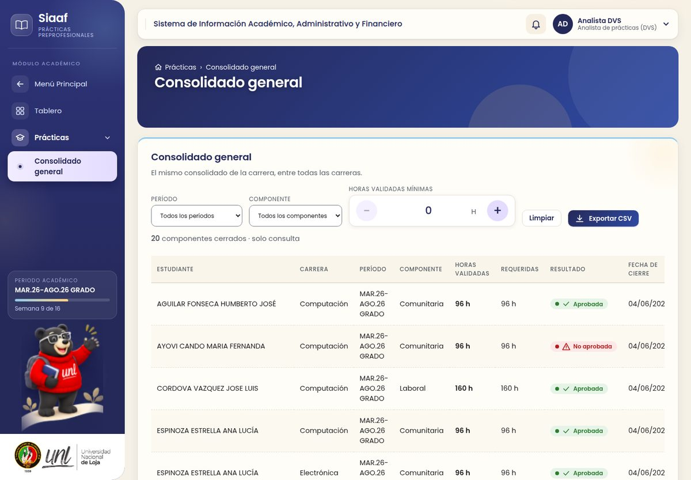
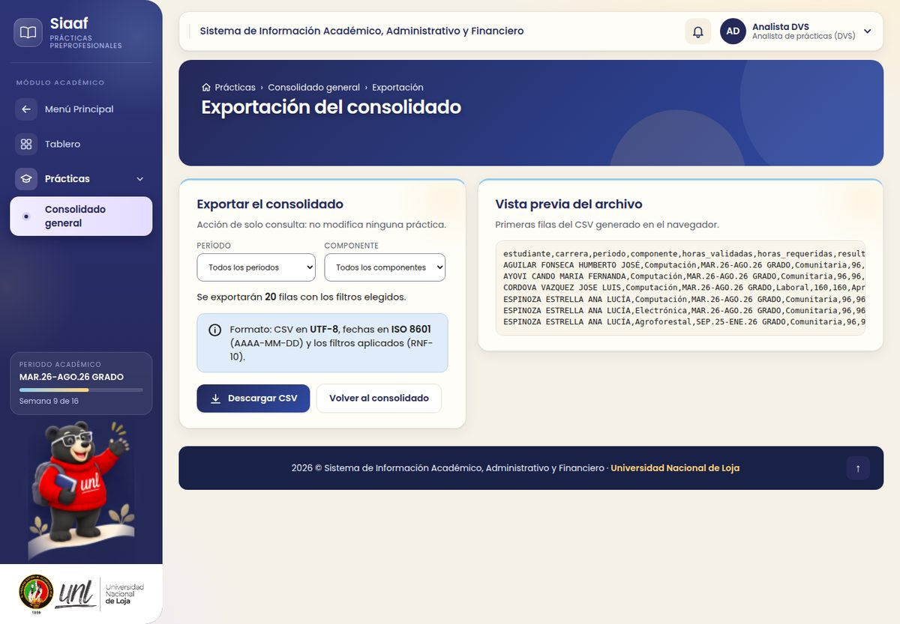

# Analista de prácticas (DVS)

[← Volver a la propuesta de diseño](../README.md)

Consulta el consolidado entre carreras y lo exporta a CSV.

**3 pantallas.** Haga clic en una imagen para verla grande; para recorrerla con sus botones y filtros, abra el archivo HTML en el navegador (empiece por `00-tablero.html`).

<table>
<tr><td width="50%" valign="top"> <b>A0 · Tablero del analista DVS</b> Resumen del consolidado entre carreras. <a href="00-tablero.html"><code>00-tablero.html</code></a></td><td width="50%" valign="top"> <b>A1 · Consolidado general</b> Consolidado entre carreras con filtros reales por período y componente; solo consulta. <a href="01-consolidado-general.html"><code>01-consolidado-general.html</code></a></td></tr><tr><td width="50%" valign="top"> <b>A2 · Exportación del consolidado</b> Descarga real de un CSV UTF-8 con fechas ISO 8601 y los filtros aplicados. <a href="02-exportacion.html"><code>02-exportacion.html</code></a></td><td></td></tr>
</table>
