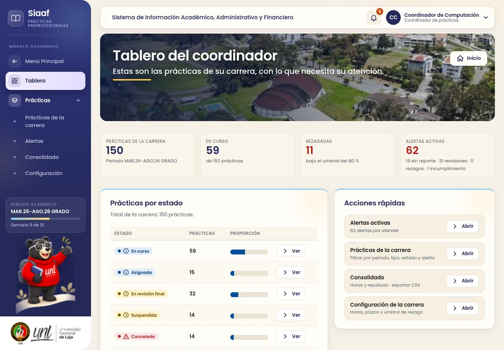
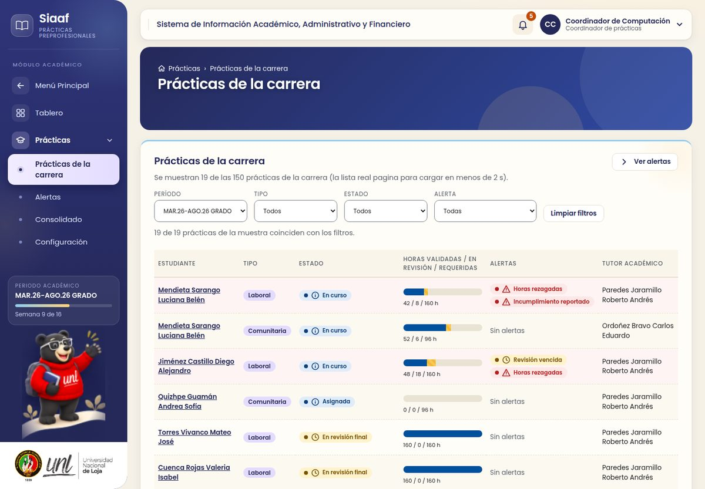
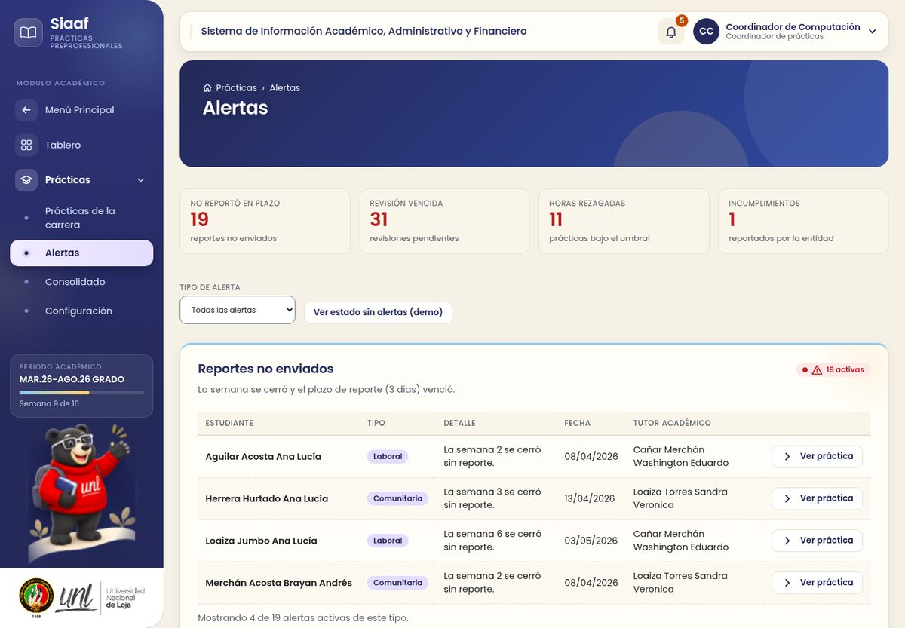
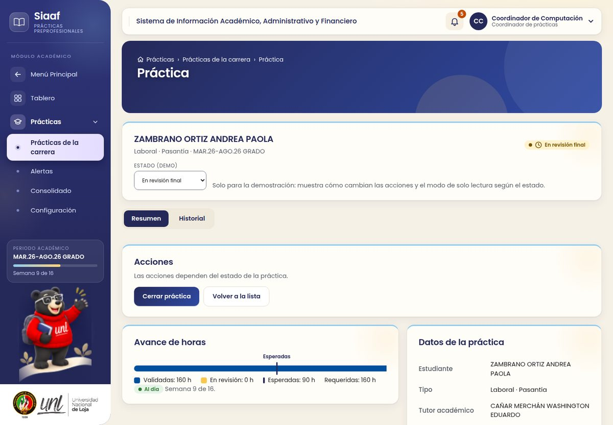
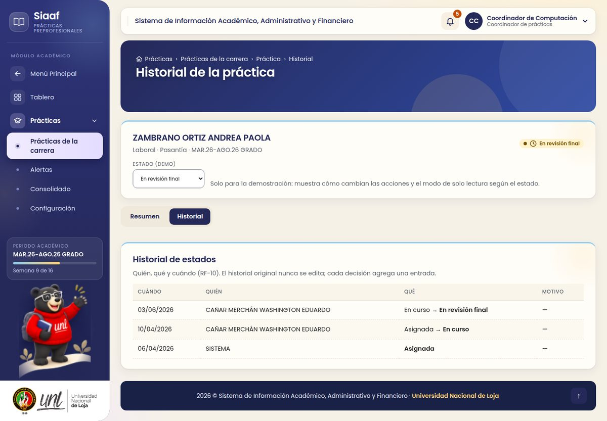
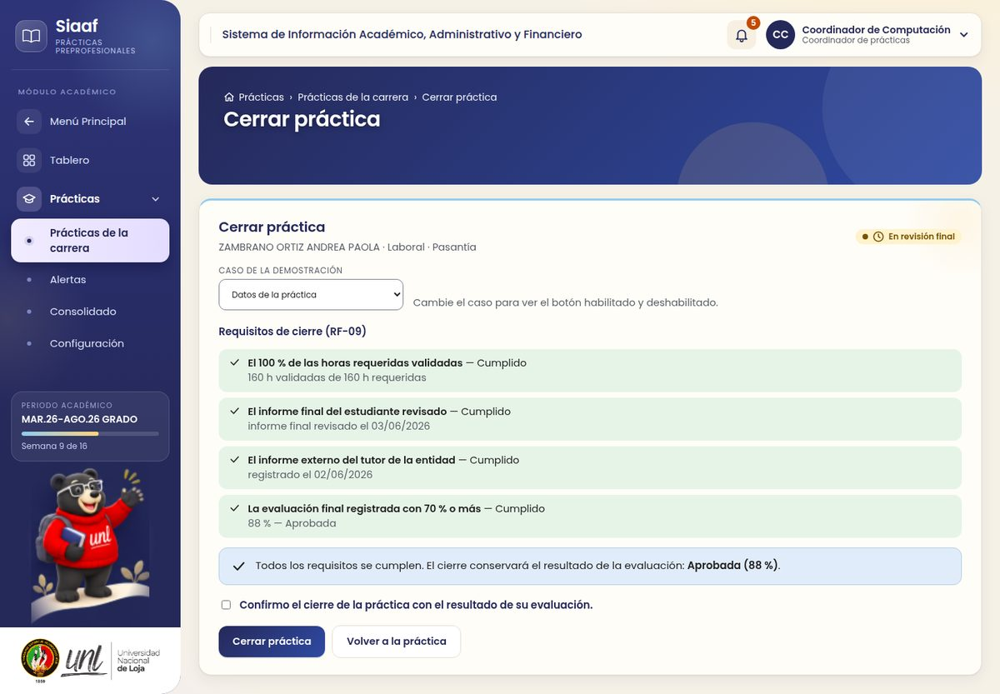
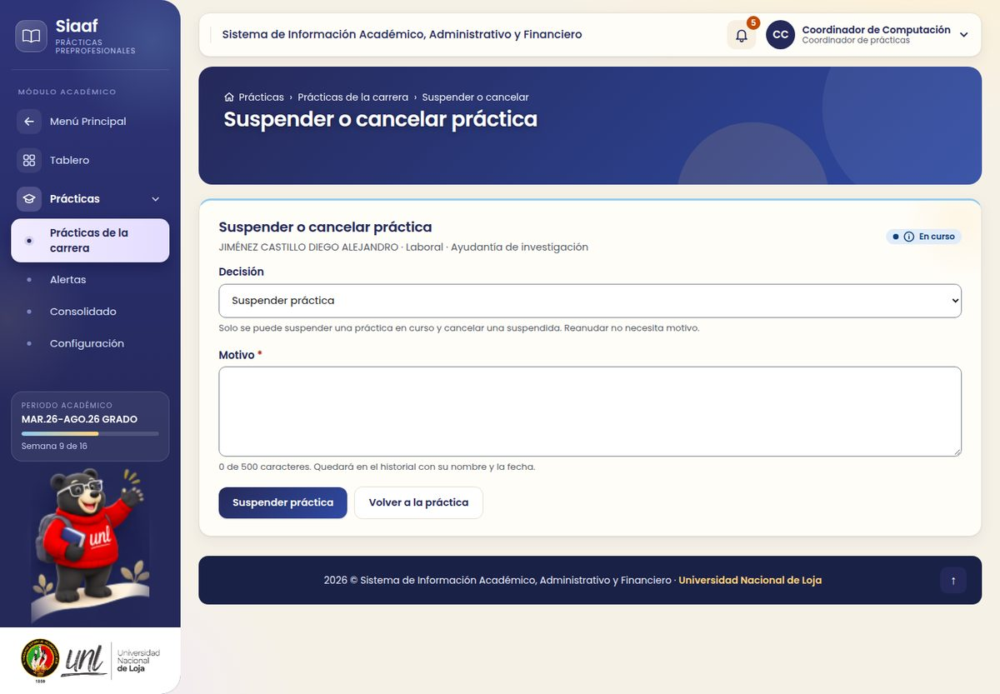
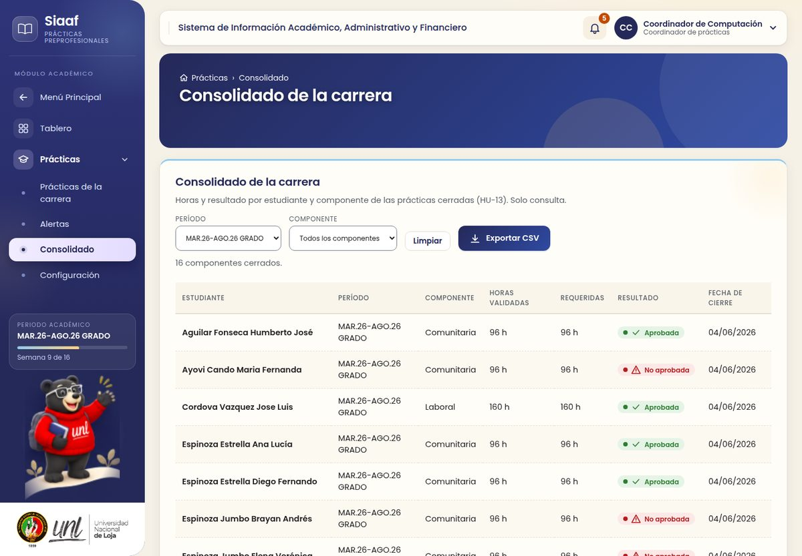
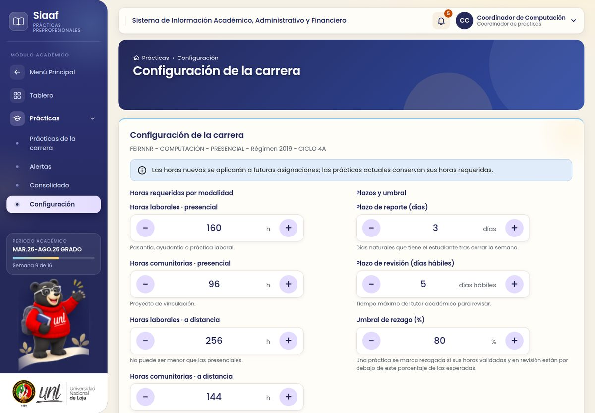

# Coordinador de prácticas

[← Volver a la propuesta de diseño](../README.md)

Responsable de prácticas de la carrera: ve el estado de todas las prácticas, atiende alertas, suspende o cierra prácticas y obtiene el consolidado.

**9 pantallas.** Haga clic en una imagen para verla grande; para recorrerla con sus botones y filtros, abra el archivo HTML en el navegador (empiece por `00-tablero.html`).

<table>
<tr><td width="50%" valign="top"> <b>C0 · Tablero del coordinador</b> Indicadores de la carrera, acciones rápidas y prácticas que esperan una decisión. <a href="00-tablero.html"><code>00-tablero.html</code></a></td><td width="50%" valign="top"> <b>C1 · Prácticas de la carrera</b> Lista de la carrera con las columnas de RF-06 y filtros por período, tipo, estado y alerta. <a href="01-practicas-carrera.html"><code>01-practicas-carrera.html</code></a></td></tr><tr><td width="50%" valign="top"> <b>C2 · Alertas</b> Alertas activas por tipo: reportes no enviados, revisiones pendientes, horas rezagadas e incumplimientos; incluye el estado vacío. <a href="02-alertas.html"><code>02-alertas.html</code></a></td><td width="50%" valign="top"> <b>C3 · Práctica</b> Detalle de la práctica (compartido con T4), con las acciones Cerrar, Suspender, Reanudar y Cancelar según el estado y sus variantes de solo lectura. <a href="03-practica.html"><code>03-practica.html</code></a></td></tr><tr><td width="50%" valign="top"> <b>C3 · Historial de la práctica</b> Pestaña Historial de la práctica: quién, qué y cuándo de cada cambio de estado. <a href="03b-historial.html"><code>03b-historial.html</code></a></td><td width="50%" valign="top"> <b>C4 · Cerrar práctica</b> Cierre con la lista de requisitos de RF-09; el botón se bloquea y lista lo que falta salvo que se cumpla todo. <a href="04-cerrar-practica.html"><code>04-cerrar-practica.html</code></a></td></tr><tr><td width="50%" valign="top"> <b>C5 · Suspender o cancelar práctica</b> Formulario con motivo obligatorio (RF-13): error si está vacío y aviso de éxito. <a href="05-suspender-cancelar.html"><code>05-suspender-cancelar.html</code></a></td><td width="50%" valign="top"> <b>C6 · Consolidado de la carrera</b> Horas y resultado por estudiante y componente, con filtros y exportación real a CSV (RNF-10). <a href="06-consolidado.html"><code>06-consolidado.html</code></a></td></tr><tr><td width="50%" valign="top"> <b>C7 · Configuración de la carrera</b> Horas requeridas por modalidad, plazos de reporte y de revisión y umbral de rezago, con validación (RF-12). <a href="07-configuracion.html"><code>07-configuracion.html</code></a></td><td></td></tr>
</table>
