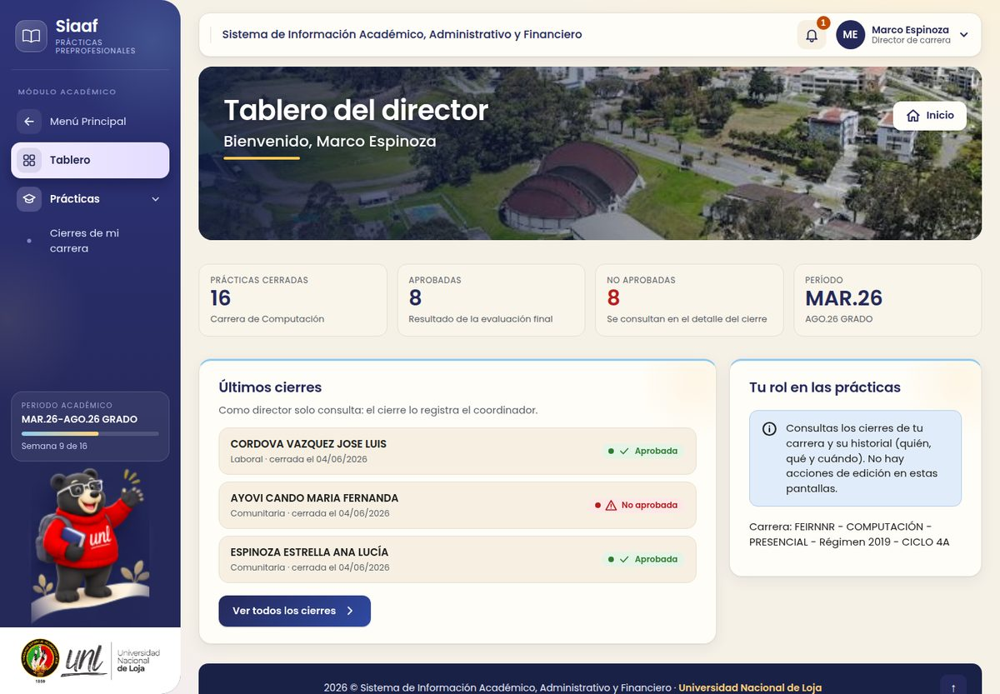
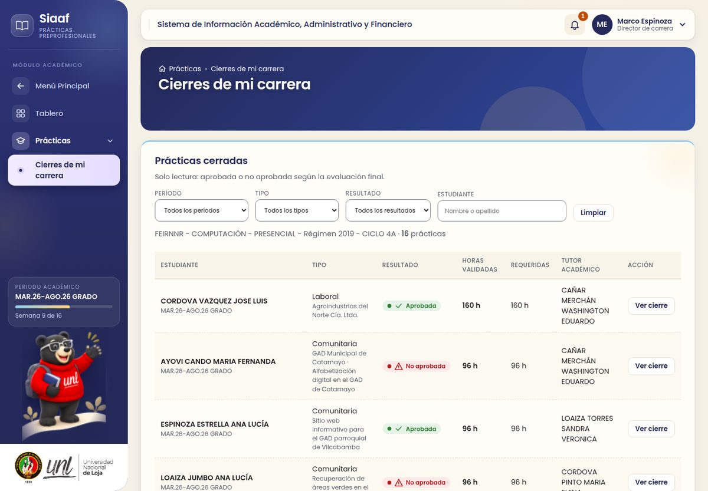
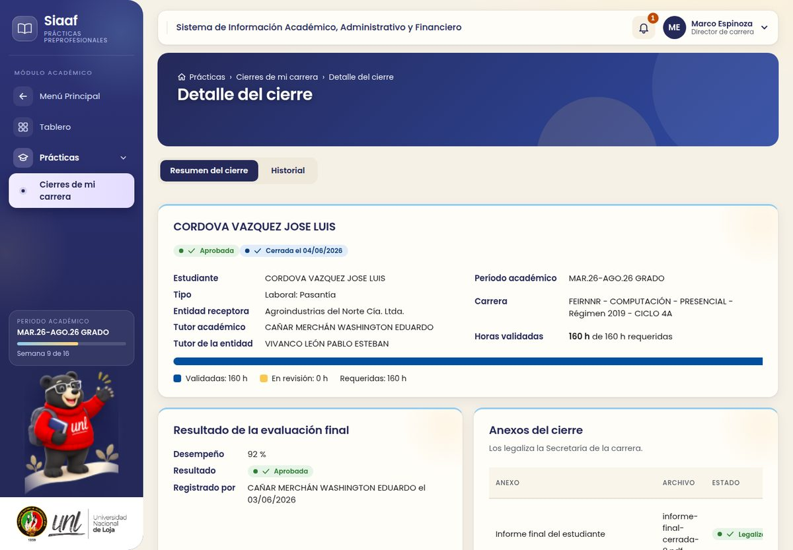
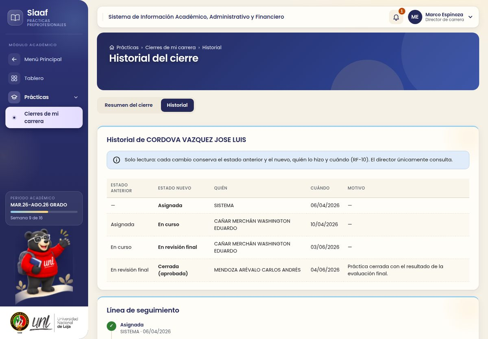

# Director de carrera

[← Volver a la propuesta de diseño](../README.md)

Consulta los cierres de su carrera y su historial, en solo lectura.

**4 pantallas.** Haga clic en una imagen para verla grande; para recorrerla con sus botones y filtros, abra el archivo HTML en el navegador (empiece por `00-tablero.html`).

<table>
<tr><td width="50%" valign="top"> <b>D0 · Tablero del director</b> Resumen de los cierres de su carrera. <a href="00-tablero.html"><code>00-tablero.html</code></a></td><td width="50%" valign="top"> <b>D1 · Cierres de mi carrera</b> Lista de solo lectura de las prácticas cerradas de la carrera. <a href="01-cierres.html"><code>01-cierres.html</code></a></td></tr><tr><td width="50%" valign="top"> <b>D2 · Detalle del cierre</b> Datos, resultado y anexos de una práctica cerrada, solo lectura. <a href="02-detalle-cierre.html"><code>02-detalle-cierre.html</code></a></td><td width="50%" valign="top"> <b>D2 · Historial del cierre</b> Pestaña Historial: quién, qué y cuándo, solo lectura. <a href="03-historial.html"><code>03-historial.html</code></a></td></tr>
</table>
