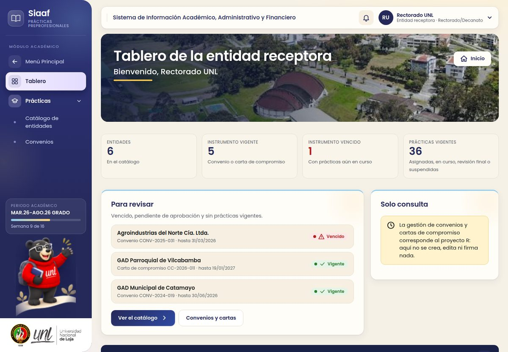
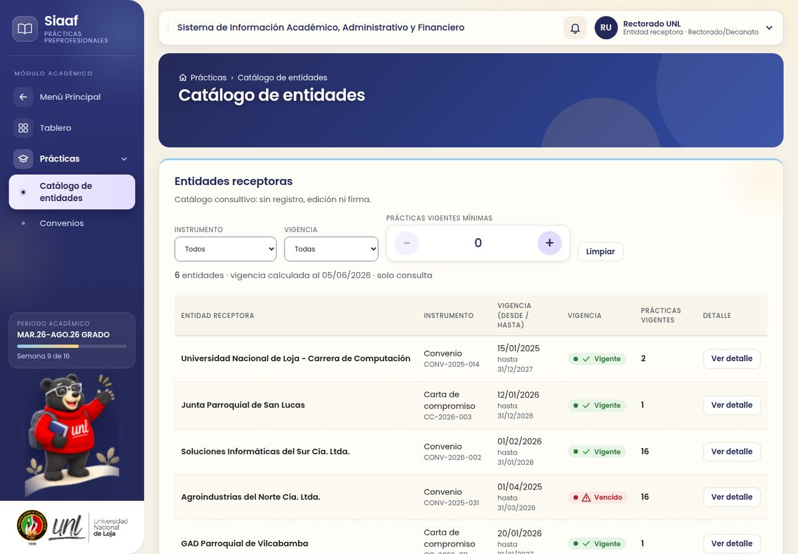
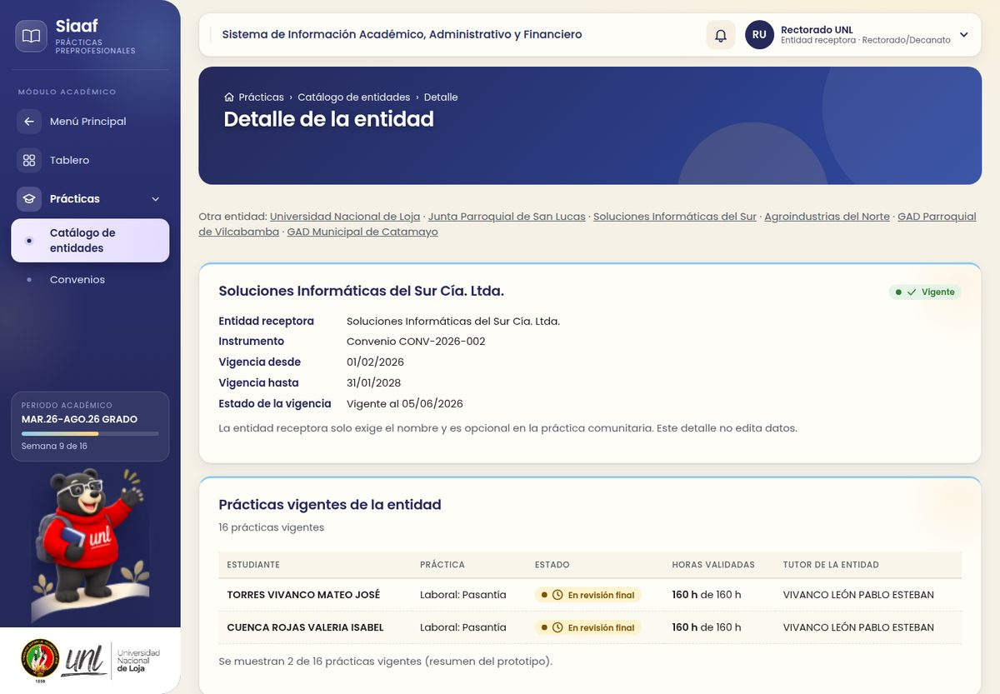
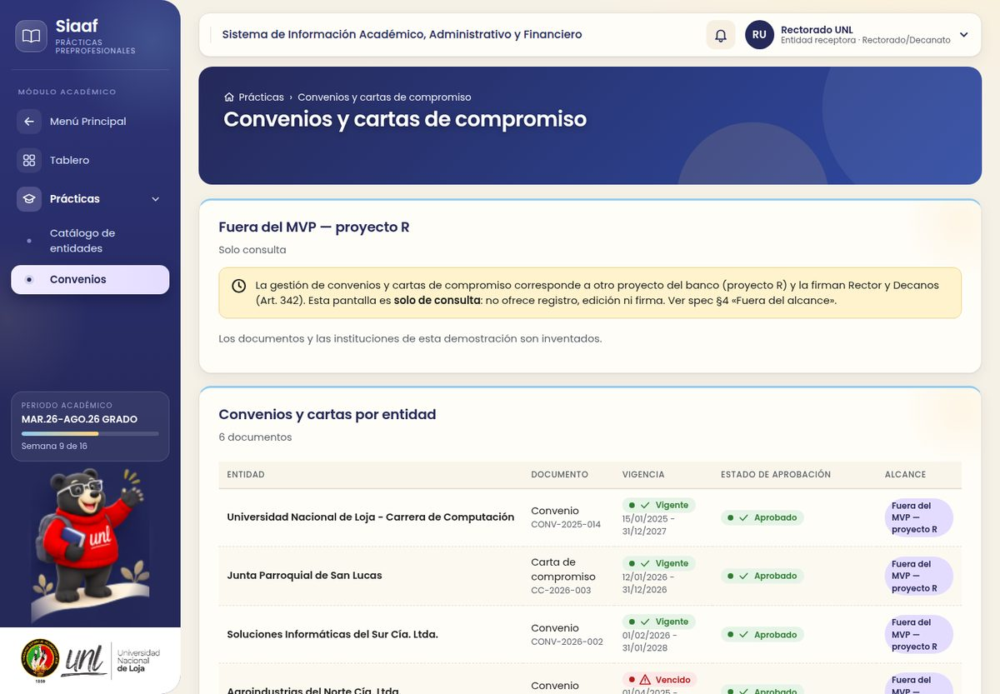

# Entidad receptora · Rectorado/Decanato

[← Volver a la propuesta de diseño](../README.md)

Consulta el catálogo de entidades receptoras y los convenios (fuera del MVP, solo consulta).

**4 pantallas.** Haga clic en una imagen para verla grande; para recorrerla con sus botones y filtros, abra el archivo HTML en el navegador (empiece por `00-tablero.html`).

<table>
<tr><td width="50%" valign="top"> <b>N0 · Tablero de la entidad receptora</b> Resumen del catálogo de entidades y su vigencia. <a href="00-tablero.html"><code>00-tablero.html</code></a></td><td width="50%" valign="top"> <b>N1 · Catálogo de entidades</b> Entidades con instrumento, vigencia y prácticas vigentes. <a href="01-catalogo.html"><code>01-catalogo.html</code></a></td></tr><tr><td width="50%" valign="top"> <b>N1 · Detalle de la entidad</b> Datos del instrumento y prácticas vigentes (o el vacío «sin prácticas vigentes»). <a href="02-detalle-entidad.html"><code>02-detalle-entidad.html</code></a></td><td width="50%" valign="top"> <b>N2 · Convenios y cartas de compromiso</b> Consulta de convenios y cartas, marcada «Fuera del MVP — proyecto R»; sin crear, editar ni firmar. <a href="03-convenios.html"><code>03-convenios.html</code></a></td></tr>
</table>
