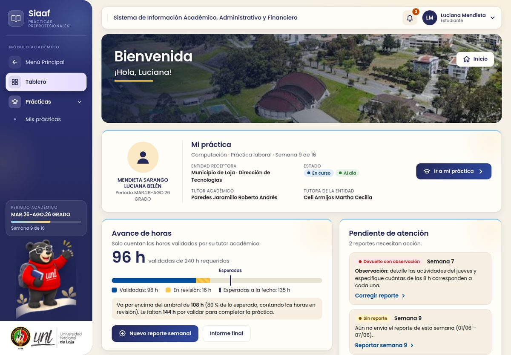
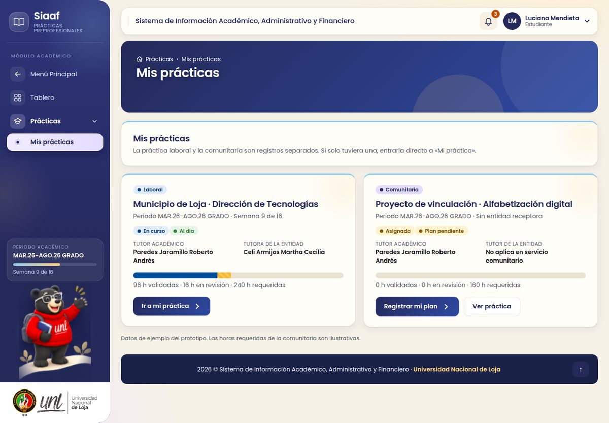
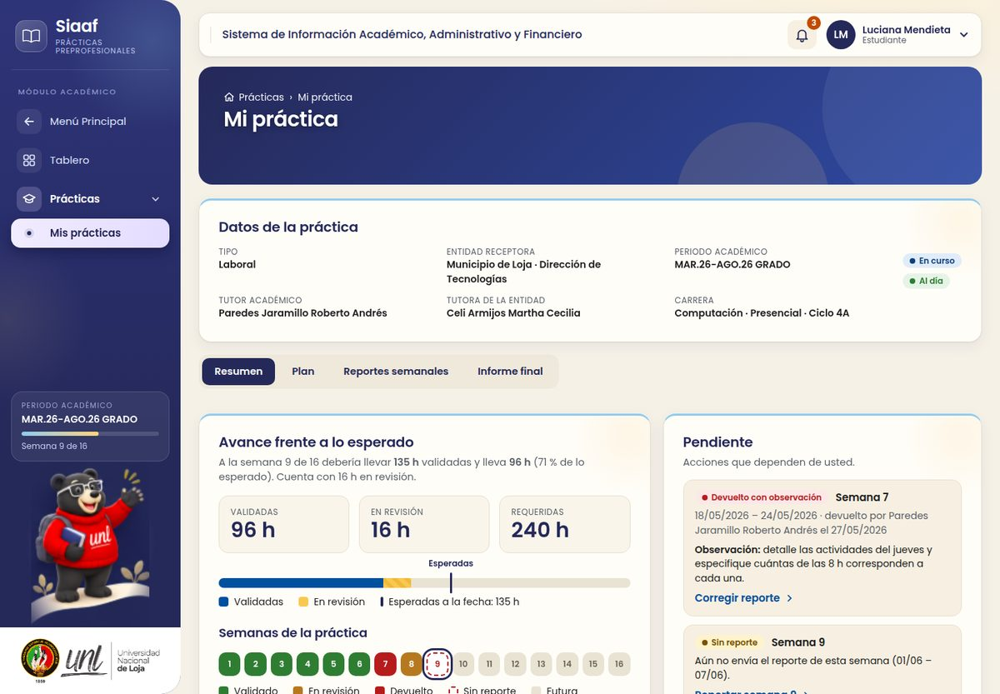
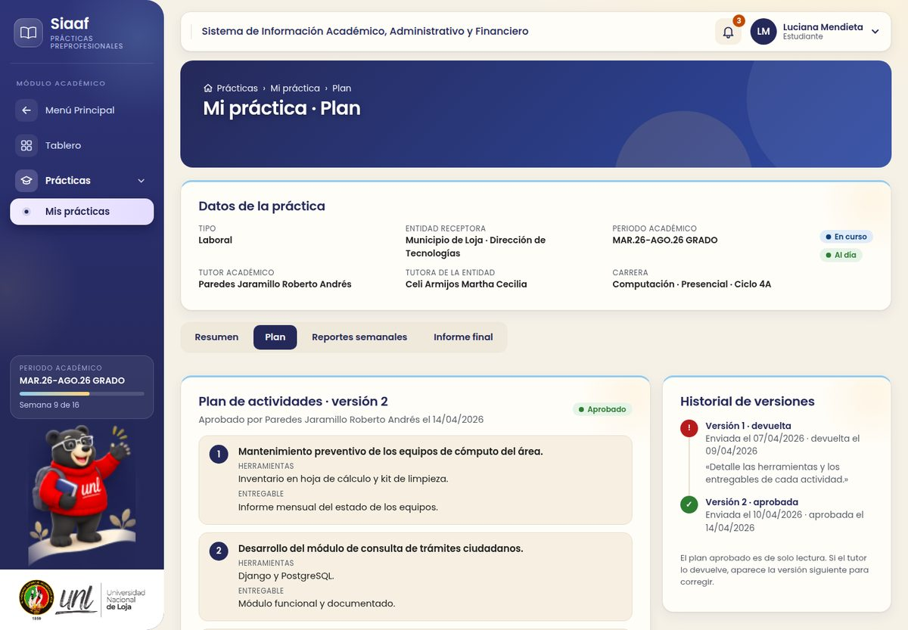
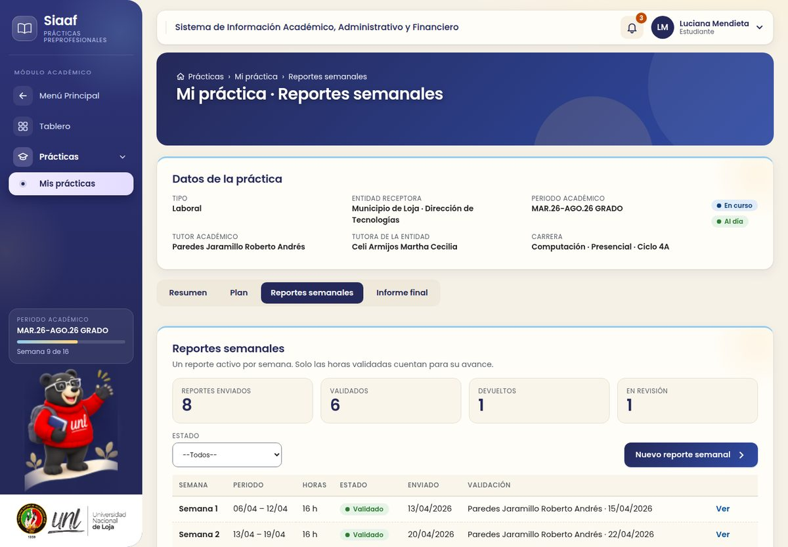
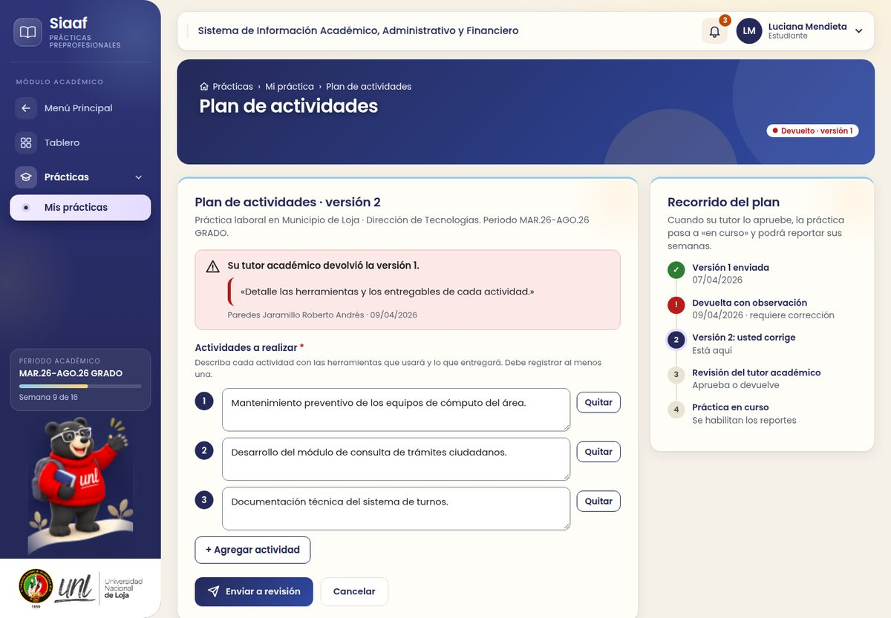
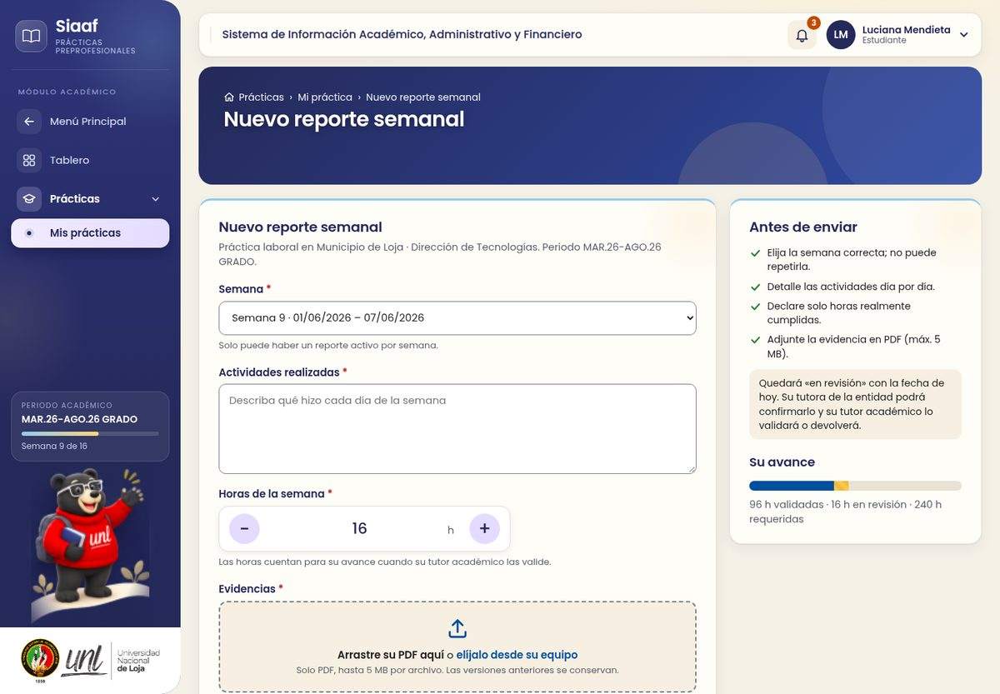
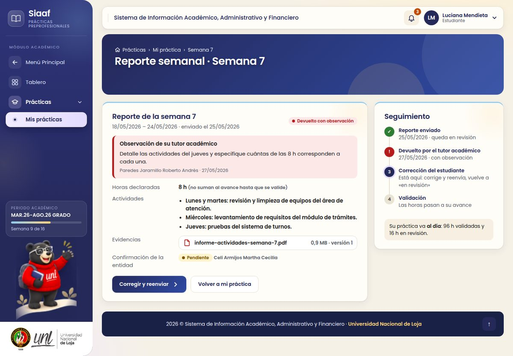
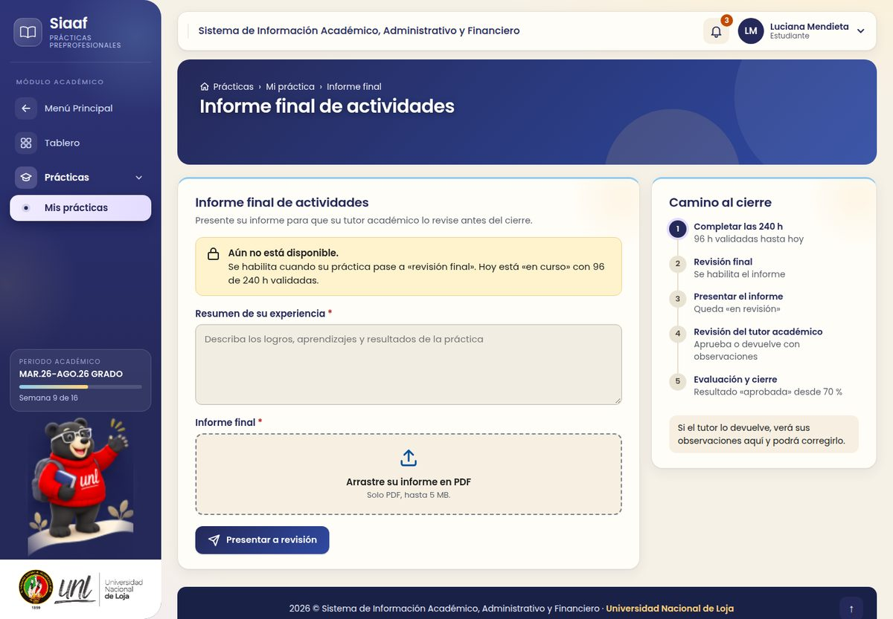

# Estudiante

[← Volver a la propuesta de diseño](../README.md)

Quien realiza la práctica: registra su plan, reporta cada semana sus horas y evidencias, presenta su informe final y ve cuántas horas lleva.

**9 pantallas.** Haga clic en una imagen para verla grande; para recorrerla con sus botones y filtros, abra el archivo HTML en el navegador (empiece por `00-tablero.html`).

<table>
<tr><td width="50%" valign="top"> <b>E0 · Tablero</b> Entrada del estudiante: estado de su práctica, avance en horas, pendientes y últimos reportes. <a href="00-tablero.html"><code>00-tablero.html</code></a></td><td width="50%" valign="top"> <b>E1 · Mis prácticas</b> Elegir entre su práctica laboral y la comunitaria. <a href="01-mis-practicas.html"><code>01-mis-practicas.html</code></a></td></tr><tr><td width="50%" valign="top"> <b>E2 · Mi práctica</b> Estado, avance en horas, las 16 semanas y lo pendiente. <a href="02-mi-practica.html"><code>02-mi-practica.html</code></a></td><td width="50%" valign="top"> <b>E2 · Pestaña Plan</b> Consultar el plan aprobado y sus versiones. <a href="03-plan-detalle.html"><code>03-plan-detalle.html</code></a></td></tr><tr><td width="50%" valign="top"> <b>E2 · Pestaña Reportes</b> Todos sus reportes por semana, con filtro por estado. <a href="04-reportes-semanales.html"><code>04-reportes-semanales.html</code></a></td><td width="50%" valign="top"> <b>E3 · Plan de actividades</b> Registrar o corregir el plan y enviarlo a revisión. <a href="05-plan-actividades.html"><code>05-plan-actividades.html</code></a></td></tr><tr><td width="50%" valign="top"> <b>E4 · Nuevo reporte semanal</b> Declarar semana, horas con contador y evidencias; con las reglas de horas. <a href="06-nuevo-reporte-semanal.html"><code>06-nuevo-reporte-semanal.html</code></a></td><td width="50%" valign="top"> <b>E5 · Reporte semanal</b> Ver el resultado de un reporte, con la observación y el seguimiento. <a href="07-reporte-semanal.html"><code>07-reporte-semanal.html</code></a></td></tr><tr><td width="50%" valign="top"> <b>E6 · Informe final</b> Presentar el informe al cierre; bloqueado hasta la revisión final. <a href="08-informe-final.html"><code>08-informe-final.html</code></a></td><td></td></tr>
</table>
