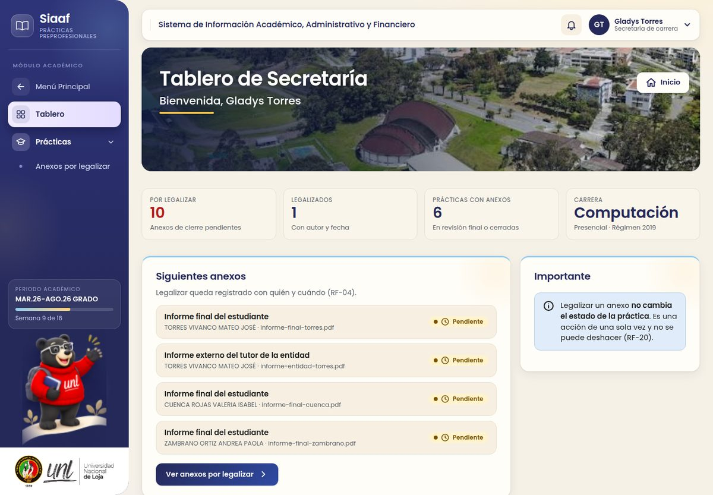
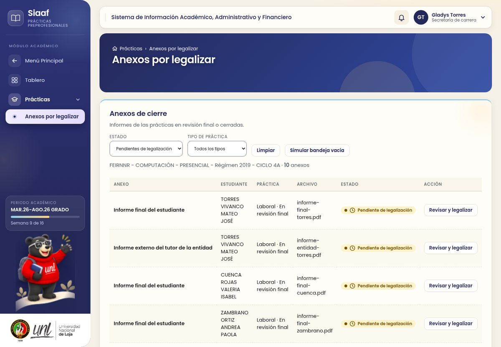
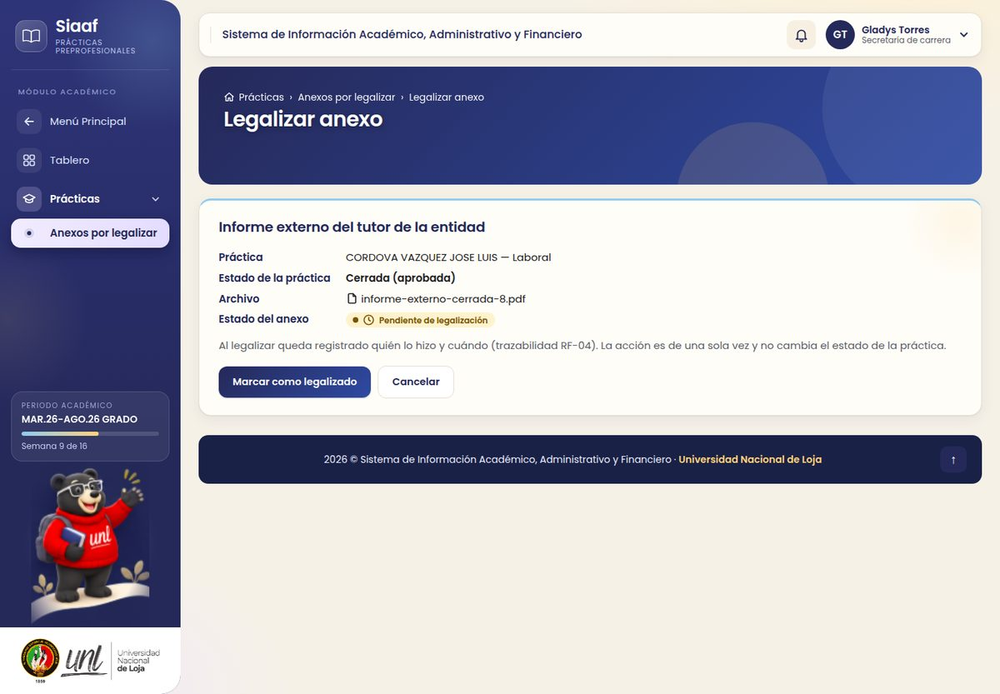

# Secretaría de carrera

[← Volver a la propuesta de diseño](../README.md)

Legaliza los anexos de cierre de las prácticas.

**3 pantallas.** Haga clic en una imagen para verla grande; para recorrerla con sus botones y filtros, abra el archivo HTML en el navegador (empiece por `00-tablero.html`).

<table>
<tr><td width="50%" valign="top"> <b>S0 · Tablero de Secretaría</b> Resumen de los anexos por legalizar. <a href="00-tablero.html"><code>00-tablero.html</code></a></td><td width="50%" valign="top"> <b>S1 · Anexos por legalizar</b> Lista de anexos pendientes y legalizados, con variante vacía. <a href="01-anexos.html"><code>01-anexos.html</code></a></td></tr><tr><td width="50%" valign="top"> <b>S2 · Legalizar anexo</b> Legalización de una sola vez con autor y fecha; no cambia el estado de la práctica. <a href="02-legalizar.html"><code>02-legalizar.html</code></a></td><td></td></tr>
</table>
