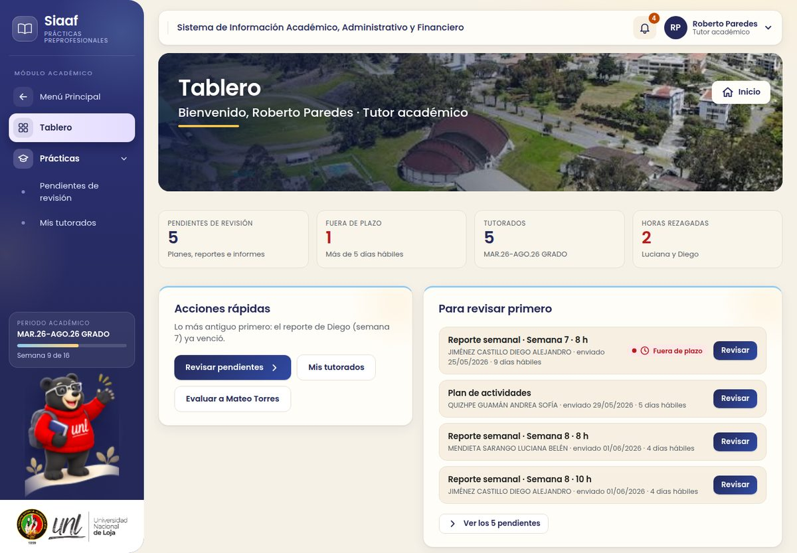
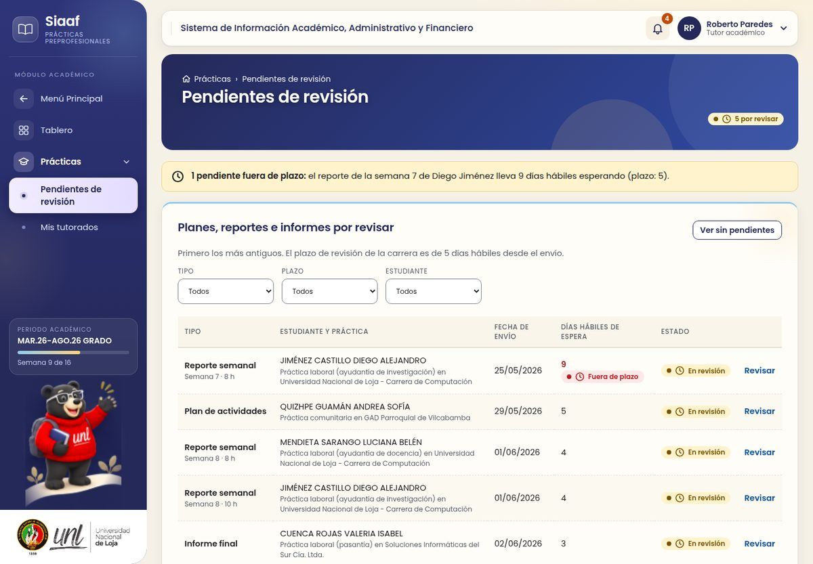
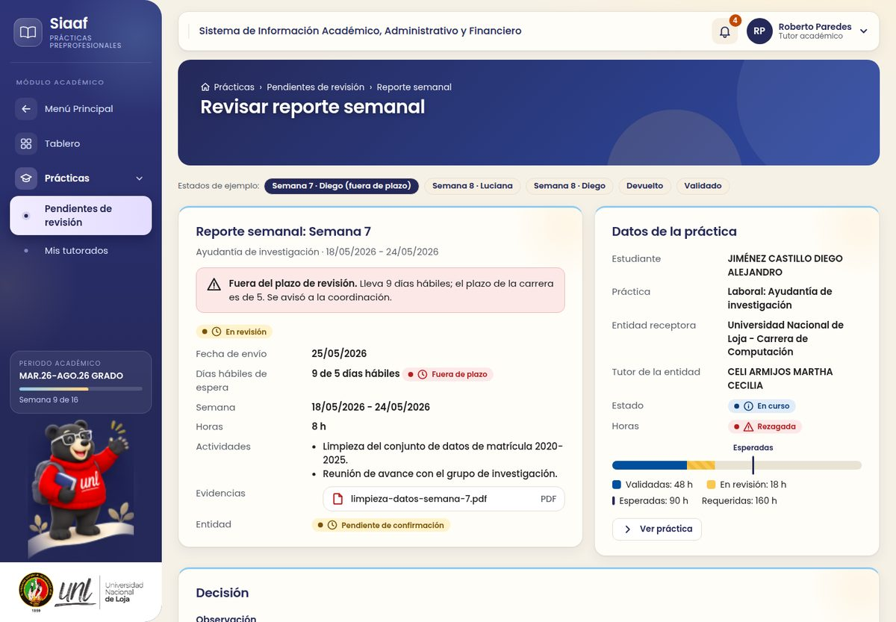
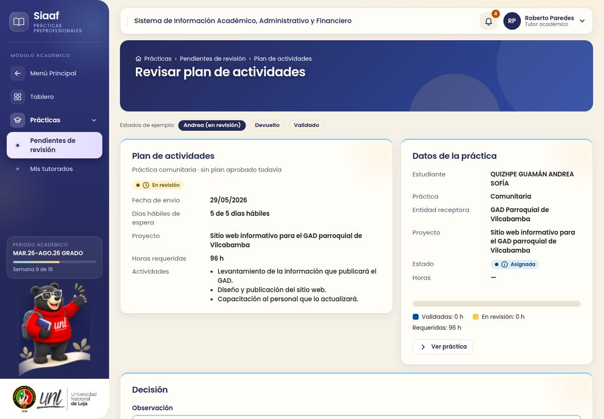
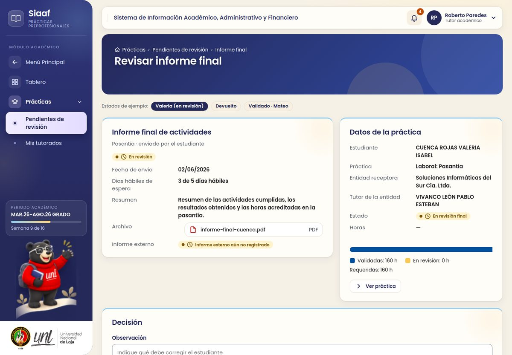
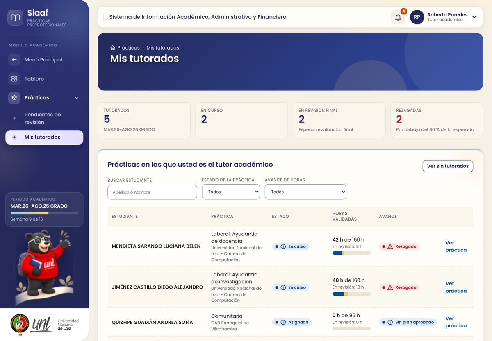
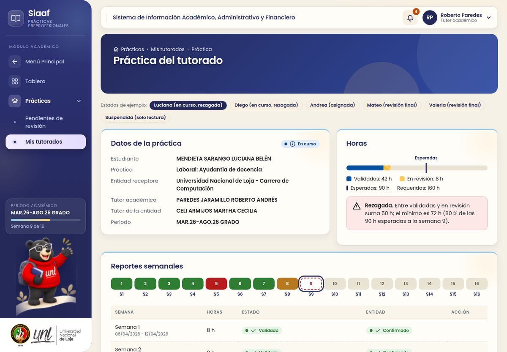
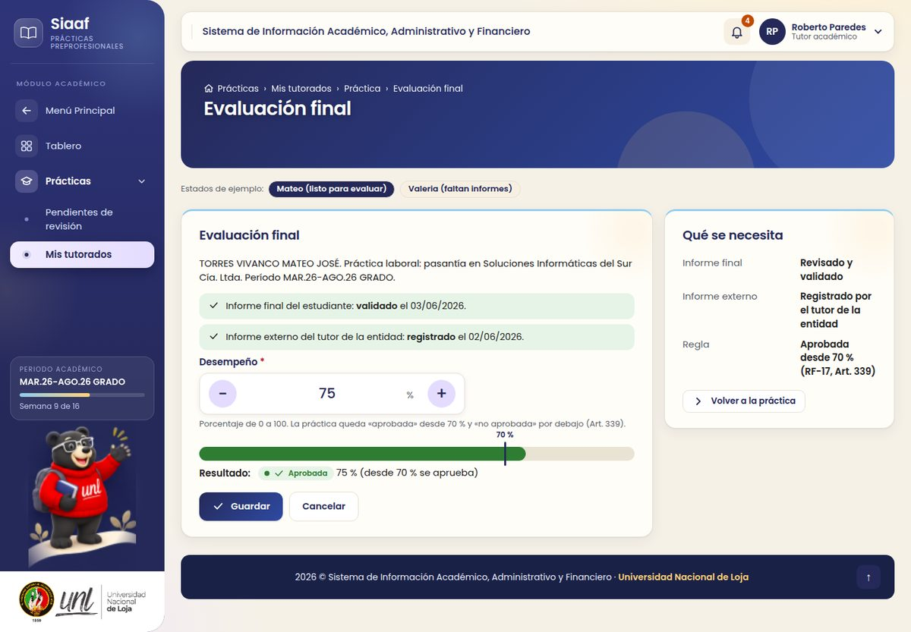

# Tutor académico

[← Volver a la propuesta de diseño](../README.md)

Docente que acompaña la práctica: revisa planes, reportes e informes finales, registra la evaluación y sigue a sus tutorados.

**8 pantallas.** Haga clic en una imagen para verla grande; para recorrerla con sus botones y filtros, abra el archivo HTML en el navegador (empiece por `00-tablero.html`).

<table>
<tr><td width="50%" valign="top"> <b>TA0 · Tablero del tutor académico</b> Pendientes por revisar, tutorados y accesos rápidos. <a href="00-tablero.html"><code>00-tablero.html</code></a></td><td width="50%" valign="top"> <b>T1 · Pendientes de revisión</b> Bandeja de planes, reportes e informes finales por revisar, con días de espera y marca de fuera de plazo. <a href="01-pendientes.html"><code>01-pendientes.html</code></a></td></tr><tr><td width="50%" valign="top"> <b>T2 · Revisar reporte semanal</b> Validar o devolver (con observación obligatoria) un reporte semanal de un tutorado. <a href="02-revisar-reporte.html"><code>02-revisar-reporte.html</code></a></td><td width="50%" valign="top"> <b>T2 · Revisar plan de actividades</b> Validar o devolver el plan de actividades de una práctica asignada. <a href="03-revisar-plan.html"><code>03-revisar-plan.html</code></a></td></tr><tr><td width="50%" valign="top"> <b>T2 · Revisar informe final</b> Validar o devolver el informe final de actividades de un tutorado. <a href="04-revisar-informe.html"><code>04-revisar-informe.html</code></a></td><td width="50%" valign="top"> <b>T3 · Mis tutorados</b> Lista de prácticas que tutoriza, con estado, horas y si va al día o rezagada. <a href="05-mis-tutorados.html"><code>05-mis-tutorados.html</code></a></td></tr><tr><td width="50%" valign="top"> <b>T4 · Práctica del tutorado</b> Detalle de la práctica: datos, horas, reportes, plan, informes, incumplimientos e historial. <a href="06-practica.html"><code>06-practica.html</code></a></td><td width="50%" valign="top"> <b>T5 · Evaluación final</b> Registrar el porcentaje de desempeño; muestra en vivo el resultado (aprobada desde 70 %). <a href="07-evaluacion-final.html"><code>07-evaluacion-final.html</code></a></td></tr>
</table>
