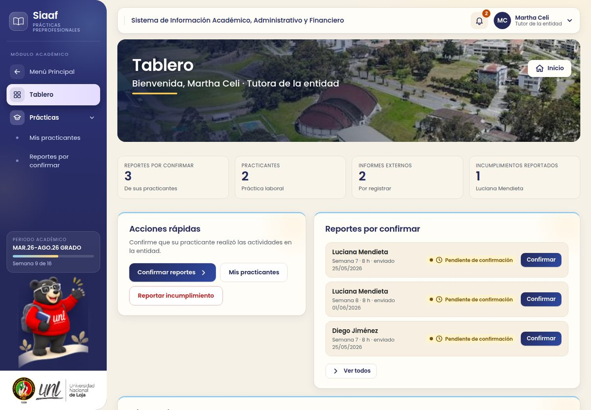
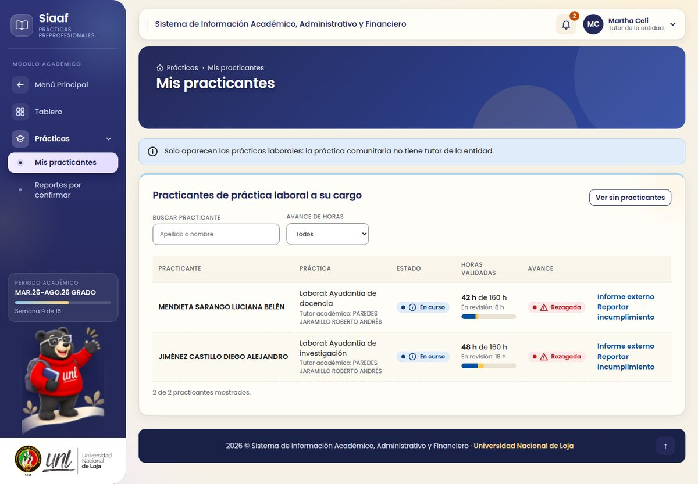
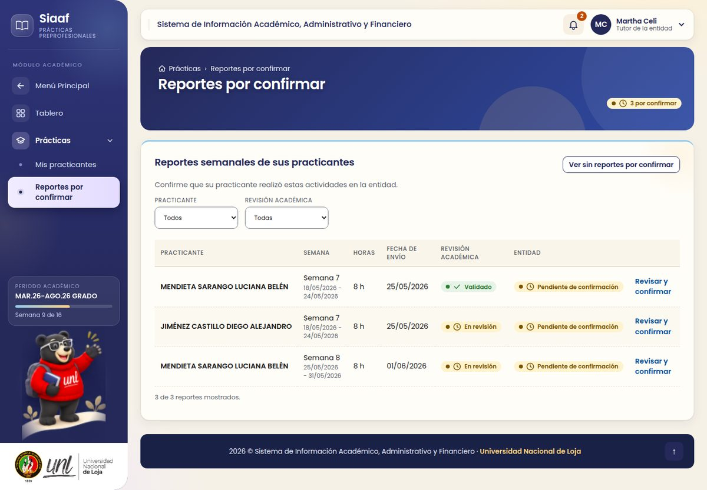
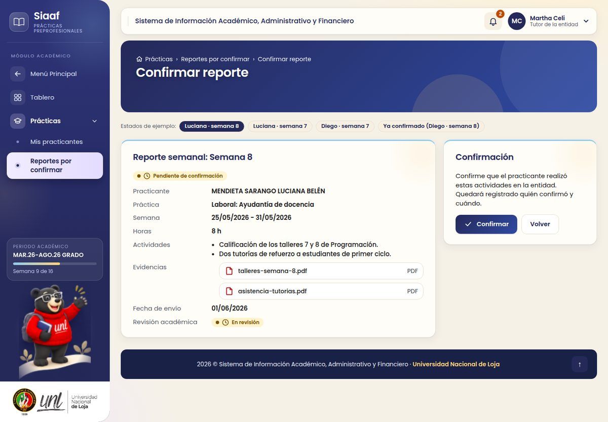
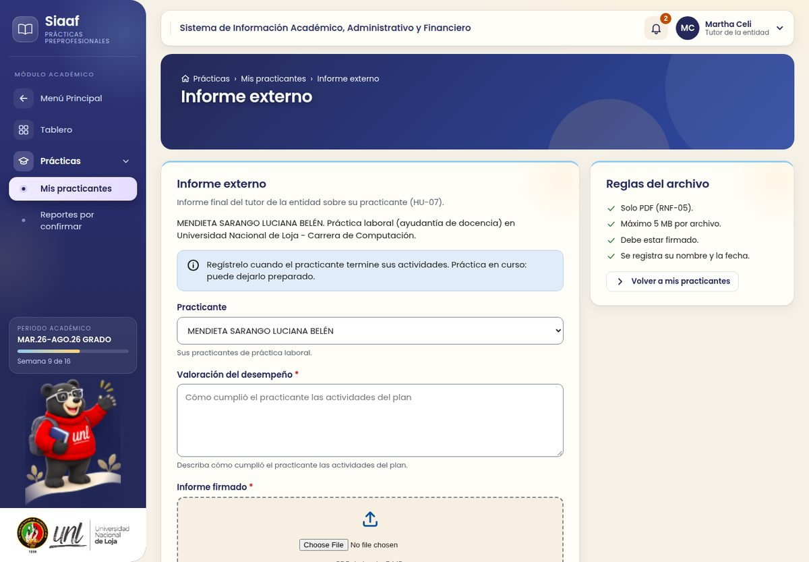
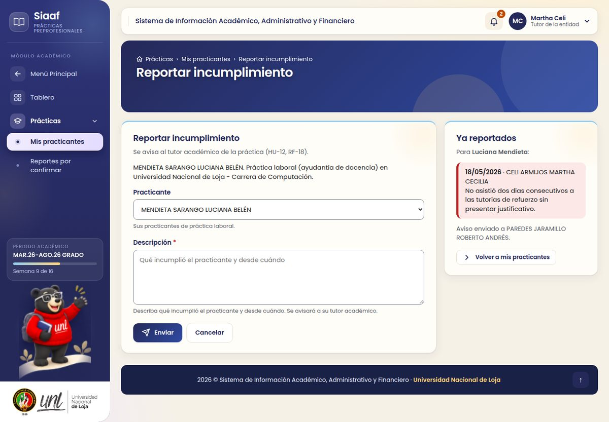

# Tutor de la entidad

[← Volver a la propuesta de diseño](../README.md)

Persona de la entidad receptora: confirma los reportes de sus practicantes, registra su informe y reporta incumplimientos.

**6 pantallas.** Haga clic en una imagen para verla grande; para recorrerla con sus botones y filtros, abra el archivo HTML en el navegador (empiece por `00-tablero.html`).

<table>
<tr><td width="50%" valign="top"> <b>TE0 · Tablero del tutor de la entidad</b> Reportes por confirmar, practicantes y accesos rápidos. <a href="00-tablero.html"><code>00-tablero.html</code></a></td><td width="50%" valign="top"> <b>R1 · Mis practicantes</b> Practicantes de práctica laboral con estado, horas y accesos al informe externo y al incumplimiento. <a href="01-mis-practicantes.html"><code>01-mis-practicantes.html</code></a></td></tr><tr><td width="50%" valign="top"> <b>R2 · Reportes por confirmar</b> Reportes semanales de sus practicantes que aún no confirmó. <a href="02-reportes-por-confirmar.html"><code>02-reportes-por-confirmar.html</code></a></td><td width="50%" valign="top"> <b>R3 · Confirmar reporte</b> Ver el reporte semanal del practicante y confirmarlo; queda registrado quién confirmó y cuándo. <a href="03-confirmar-reporte.html"><code>03-confirmar-reporte.html</code></a></td></tr><tr><td width="50%" valign="top"> <b>R4 · Informe externo</b> Registrar el informe final del tutor de la entidad (valoración y PDF firmado de hasta 5 MB). <a href="04-informe-externo.html"><code>04-informe-externo.html</code></a></td><td width="50%" valign="top"> <b>R5 · Reportar incumplimiento</b> Describir el incumplimiento de un practicante (obligatorio); avisa al tutor académico. <a href="05-reportar-incumplimiento.html"><code>05-reportar-incumplimiento.html</code></a></td></tr>
</table>
