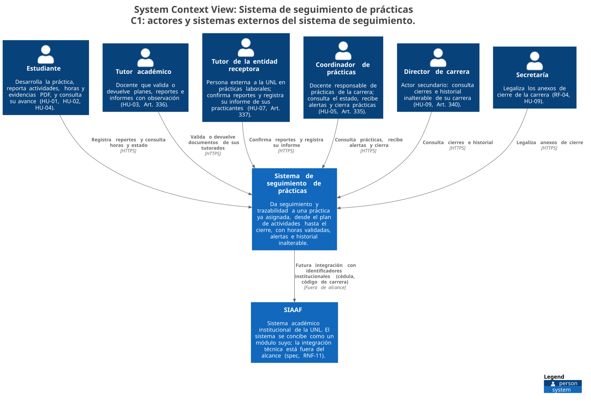
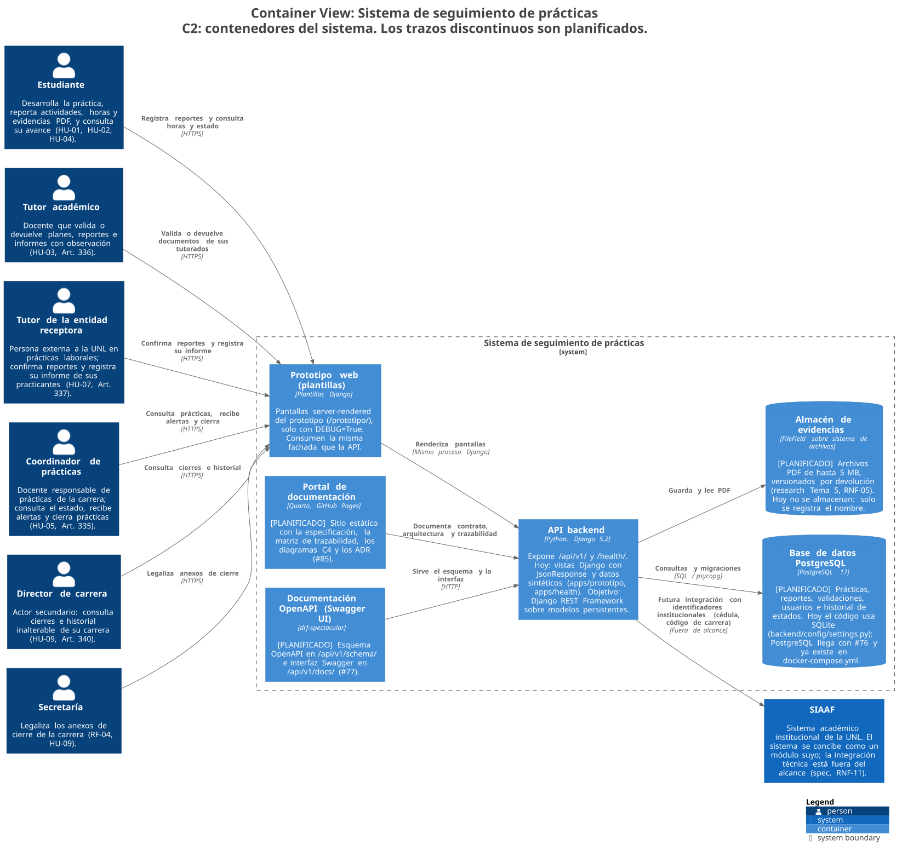
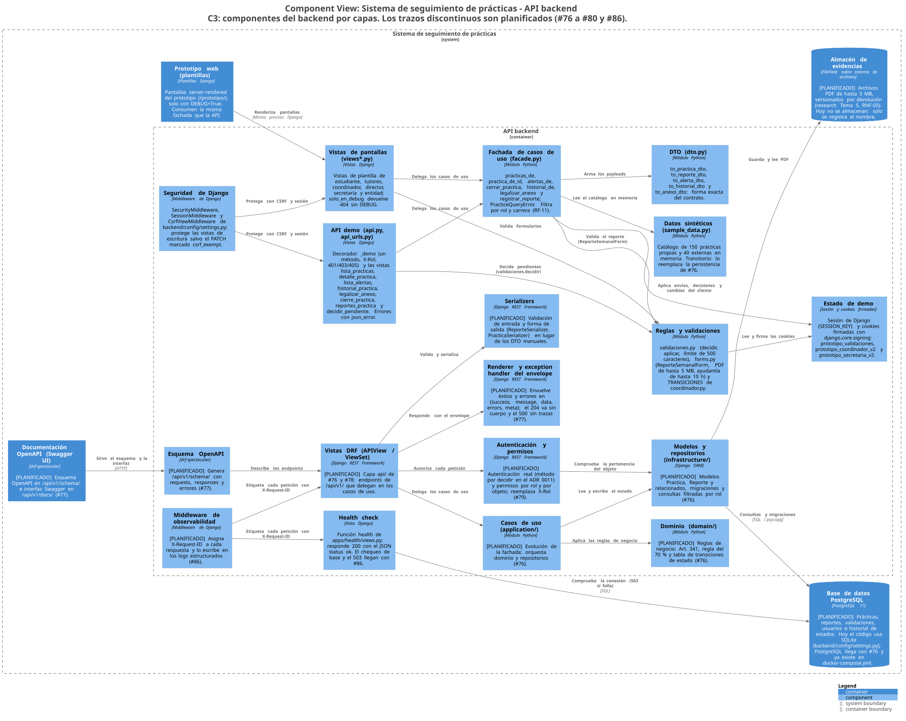
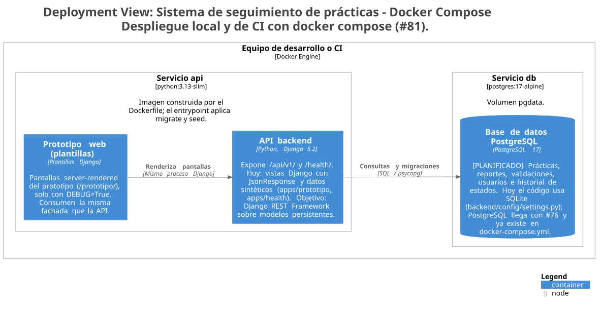
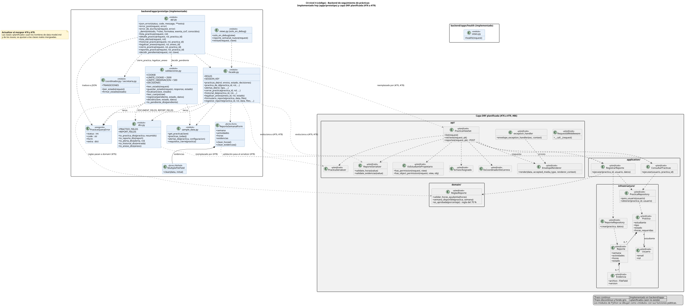

Modelo C4 del sistema en Structurizr DSL (`docs/arquitectura/workspace.dsl`, fuente única de los cuatro primeros diagramas) y diagrama de clases en PlantUML. El diagrama de código ya está actualizado a los módulos reales de `backend/apps/` ([ADR 0010](../adr/0010-adoptar-django-rest-framework-y-postgresql.md) y [ADR 0011](../adr/0011-metodo-de-autenticacion-de-la-api.md), aceptados). Los SVG de C2, C3 y despliegue se generaron al mergear #91 y **conservan todavía** las marcas `[PLANIFICADO]` de la capa DRF y de PostgreSQL, que ya existen en el código: regenerarlos con `structurizr/structurizr` es una tarea pendiente ([README de arquitectura](../arquitectura/README.md)).

La decisión de fondo es un [monolito modular con DTO y Facade](../adr/0008-monolito-modular-con-dto-y-facade.md); el resto está en el [índice de ADR](../adr/README.md) y en [arquitectura y patrones](../arquitectura.md).

## C1: contexto

{#fig-c1 fig-alt="Diagrama C1 de contexto del sistema"}

Seis actores (estudiante, tutor académico, tutor de la entidad, coordinador, director y secretaría) y el SIAAF como sistema externo fuera del alcance.

## C2: contenedores

{#fig-c2 fig-alt="Diagrama C2 de contenedores"}

API backend, prototipo web, PostgreSQL (conectado vía `POSTGRES_*` desde el merge #98), almacén de evidencias, Swagger UI y OpenAPI (real desde #100) y este portal Quarto.

## C3: componentes del backend

{#fig-c3 fig-alt="Diagrama C3 de componentes del backend"}

Componentes reales: seguridad de Django y `apps.seguridad` (JWT, `rol_requerido`, `PermitirPracticaVisible`), `apps.contrato` (envelope), las vistas DRF de `apps.practicas` y `apps.reportes`, los servicios de `apps.actividades` y `apps.practicas`, los modelos de `apps.usuarios`, `apps.carreras`, `apps.entidades`, `apps.practicas`, `apps.actividades`, `apps.reportes` y `apps.auditoria`, la observabilidad de `apps.observability` y, aislado, el demo (`apps.prototipo`): API JSON con `X-Rol`, fachada, DTO y estado en cookies firmadas.

## Despliegue

{#fig-d1 fig-alt="Diagrama de despliegue"}

## C4 nivel 4 y UML de clases

{#fig-codigo fig-alt="Diagrama de clases del backend"}

El diagrama muestra los módulos y clases de producción de `backend/apps/` con sus funciones públicas: `SuccessEnvelopeRenderer` y el exception handler del contrato universal, `JWTAuthentication` de simplejwt con `rol_requerido()` y `PermitirPracticaVisible`, `Practica`, `asignar_practica` y `cambiar_estado_practica`, `PlanActividades` y `Validacion` con sus servicios, `ReporteSemanal` con su serializer y su vista, `Usuario` con `practicas_visibles_para`, `HistorialEstado` con su queryset de solo inserción, `ConfiguracionCarrera` y el middleware de `X-Request-ID`. El paquete del demo se dibuja aparte y punteado porque sigue en pie bajo `/prototipo/`.

## Cómo regenerar

Las órdenes para validar el DSL y regenerar los SVG con Docker están en el [README de arquitectura](../arquitectura/README.md). Los archivos fuente (`workspace.dsl` y `c4-codigo.puml`) están en `docs/arquitectura/`.
