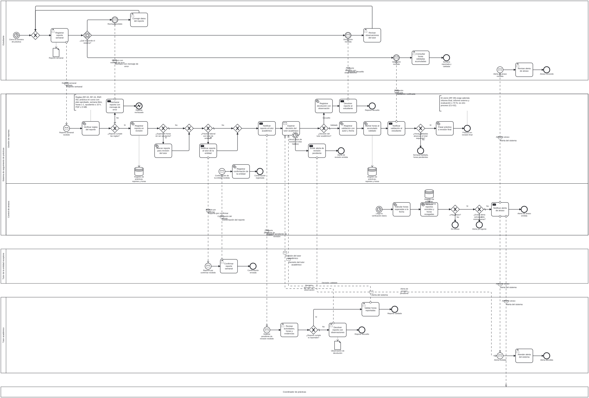

Proceso principal del incremento: el estudiante reporta cada semana, el tutor valida o devuelve, el sistema acumula horas y genera alertas de atraso. Cubre HU-02, HU-03, HU-04, HU-06 y HU-07, y los requisitos RF-02 a RF-05, RF-07 y RF-08.

{#fig-bpmn fig-alt="Diagrama BPMN con los pools Estudiante, Sistema de seguimiento, Tutor de la entidad, Tutor académico y Coordinador"}

El diagrama es grande. Haz clic para ampliarlo, o abre el [archivo `.bpmn`](https://github.com/Jaimewww/sistema-practicas-preprofesionales-unl/blob/develop/docs/bpmn/proceso-reporte-semanal.bpmn) en <https://demo.bpmn.io/>.

## Qué contiene

| Aspecto | Detalle |
| --- | --- |
| Participantes | Estudiante, Sistema de seguimiento (lanes *Gestión de reportes* y *Control de atrasos*), Tutor de la entidad, Tutor académico y Coordinador (colapsado). |
| Convención | Cada tarea lleva verbo en infinitivo y complemento. |
| Trazabilidad | Cada actividad se relaciona con un RF, una HU o un endpoint en la tabla del análisis. |
| Elementos | Temporizadores de ciclo semanal y diario, un temporizador de frontera no interruptor de 5 días hábiles, gateways exclusivos y basados en eventos, y flujos de mensaje entre pools. |

## Documentos

- [Análisis previo al diagrama](../bpmn/analisis-proceso-reporte-semanal.md): los siete elementos (participantes, eventos, actividades, decisiones, flujos, datos y excepciones) y la tabla actividad → RF/HU → endpoint.
- [README de BPMN](../bpmn/README.md): cómo abrir y validar el diagrama, y leyenda de símbolos.

## Relación con el código

El proceso modela el comportamiento esperado. Hoy lo ejecuta el prototipo con datos sintéticos: el envío (`POST /api/v1/practicas/<id>/reportes/`), la decisión del tutor (`PATCH /prototipo/api/v1/pendientes/<clave>/`) y las alertas (`GET /prototipo/api/v1/alertas/`) existen, pero la confirmación de la entidad es una pantalla sin endpoint y la verificación diaria de atrasos no se ejecuta como tarea programada. Ver la [matriz de trazabilidad](../trazabilidad.md).
